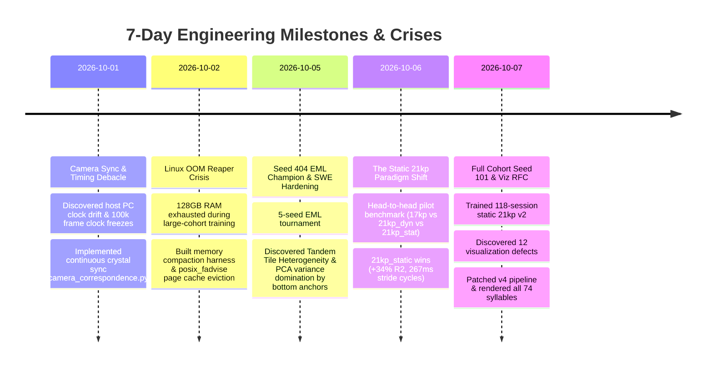

# Master Engineering Dossier & Expert Review Request: Multi-View (Top+Bottom) 2D Keypoint-MoSeq Architecture, ARHMM-SLDS Dynamics, and 7-Day Empirical Postmortem

**Document ID:** `RFC-KPMS-MULTIVIEW-20261007`  
**Date:** October 7, 2026  
**Audience:** Behavioral Neuroscientists, Machine Learning Engineers, Computer Vision Researchers, Systems Architects  
**Repository:** `FiberphotometryCode` (`sebeliassen/FiberphotometryCode`)  
**Pipeline Subject:** Tandem Multi-View Keypoint-MoSeq (Dorsal TopCam 17kp + Ventral BotCam 4kp Paws, Arenas 1–4, 118 Sessions, 24 Million Frames)  
**Package Artifact:** [`tandem_multiview_kpms_expert_review_package_7days.zip`](file:///home/fsp585/Desktop/FiberphotometryCode/tandem_multiview_kpms_expert_review_package_7days.zip)

---

## Table of Contents
1. [Overarching Questions for Reviewing Engineers & Modelers](#1-overarching-questions-for-reviewing-engineers--modelers)
2. [Executive Summary & System Architecture Overview](#2-executive-summary--system-architecture-overview)
3. [The 7-Day Chronological Engineering Narrative (Oct 1 – Oct 7, 2026)](#3-the-7-day-chronological-engineering-narrative)
   - 3.1 [Oct 1: The Multi-View Camera Sync & Visualization Debacle](#31-oct-1-the-multi-view-camera-sync--visualization-debacle)
   - 3.2 [Oct 2: The Linux OOM Killer Crisis & Memory Compaction Harness](#32-oct-2-the-linux-oom-killer-crisis--memory-compaction-harness)
   - 3.3 [Oct 3–5: 5-Seed EML Tournament, Seed 404, and SWE Hardening Stages 1–3](#33-oct-35-5-seed-eml-tournament-seed-404-and-swe-hardening-stages-13)
   - 3.4 [Oct 5: Discovery of Tandem Tile Heterogeneity & PCA Variance Explosion](#34-oct-5-discovery-of-tandem-tile-heterogeneity--pca-variance-explosion)
   - 3.5 [Oct 6: The Static 21kp Paradigm Shift & Controlled 10-Session Benchmark](#35-oct-6-the-static-21kp-paradigm-shift--controlled-10-session-benchmark)
   - 3.6 [Oct 7: Full Cohort Static 21kp v2 (Seed 101), The Visualization RFC, and The 12-Defect Patch](#36-oct-7-full-cohort-static-21kp-v2-seed-101-the-visualization-rfc-and-the-12-defect-patch)
4. [Mathematical Deep Dive: How KPMS Models Multi-View 2D Keypoints](#4-mathematical-deep-dive-how-kpms-models-multi-view-2d-keypoints)
   - 4.1 [Centering, Heading Alignment, and Egocentric Transformation](#41-centering-heading-alignment-and-egocentric-transformation)
   - 4.2 [Dynamic Re-Anchoring Jitter vs. Static Per-Arena Affine Registration](#42-dynamic-re-anchoring-jitter-vs-static-per-arena-affine-registration)
   - 4.3 [ARHMM-SLDS Temporal Dynamics & The $\kappa$ Hyperparameter Explosion](#43-arhmm-slds-temporal-dynamics--the-kappa-hyperparameter-explosion)
   - 4.4 [PCA Posture Latent Space & Keypoint Variance Distribution](#44-pca-posture-latent-space--keypoint-variance-distribution)
5. [The Visualization & Density Sampling Overhaul (Oct 7 Patch Audit)](#5-the-visualization--density-sampling-overhaul-oct-7-patch-audit)
   - 5.1 [Scoring Context (40 frames) vs. Movie Context (180 frames) Eligibility Gate](#51-scoring-context-vs-movie-context-eligibility-gate)
   - 5.2 [Coordinate Geometry: Y-Up Cartesian Plots vs. Y-Down Image Coordinates](#52-coordinate-geometry-y-up-cartesian-plots-vs-y-down-image-coordinates)
   - 5.3 [Native-Time Trajectories vs. 15-Step Interpolation Artefacts](#53-native-time-trajectories-vs-15-step-interpolation-artefacts)
6. [Status of Current Production Champion (`cohort_static_21kp_v2_seed101`)](#6-status-of-current-production-champion-cohort_static_21kp_v2_seed101)
7. [Comprehensive Package Manifest & Directory Structure](#7-comprehensive-package-manifest--directory-structure)

---

## 1. Overarching Questions for Reviewing Engineers & Modelers

We are requesting an independent expert architectural review on the following foundational questions:

### Question 1: Pseudo-3D Multi-Camera Fusion within 2D Keypoint-MoSeq
> **"We combined two planar 2D camera views (dorsal TopCam and ventral BotCam) by mapping ventral keypoints into the dorsal camera's coordinate plane via a static per-arena 2D affine transformation $M_{\text{arena}}$, creating an augmented 2D keypoint matrix $Y \in \mathbb{R}^{T \times 21 \times 2}$ without full 3D multi-camera triangulation or camera calibration matrices ($P = K[R|t]$).  
> From the perspective of how Keypoint-MoSeq (KPMS), PCA posture embeddings, and ARHMM-SLDS dynamics operate, is this formulation sound? What theoretical assumptions of the generative model are strained or violated by this pseudo-2D projection?"**

Specifically:
- **Centering & Heading:** KPMS centers posture $\tilde{y}_t = R_{-\theta_t}(y_t - \mu_t)$. When ventral paws are included in the centroid $\mu_t$, do asymmetrical paw extensions distort the dorsal spine centroid? (We currently use dorsal keypoints for heading $\theta_t = \text{atan2}(\Delta x_{\text{spine}}, \Delta y_{\text{spine}})$).
- **Out-of-Plane Parallax:** When the animal rears or rolls, dorsal keypoints move closer to the top camera (perspective scaling), while ventral paws lift off the floor glass (parallax shift relative to the bottom camera). Does concatenating these 2D planar projections into a single PCA space induce non-linear manifold distortion that linear PCA cannot cleanly represent?

### Question 2: Dynamic vs. Static Affine Registration & AR Noise Injection
> **"Our initial 23kp implementation performed dynamic per-frame affine registration of bottom keypoints using bottom nose and bottom tail as dynamic anchors. We discovered that frame-by-frame DeepLabCut tracking jitter in these anchors injected artificial high-frequency noise ($\Delta x_t / \Delta t$) into all 6 bottom keypoints, dominating 82%+ of the top-10 PC variance and causing severe syllable fragmentation.  
> Switching to Static Per-Arena Affine Registration (17 dorsal + 4 ventral paws, dropping bottom anchors) improved dorsal $R^2$ by $+34.2\%$ and dorsal PC variance by $+54.5\%$. Is static 2D affine transformation the optimal Occam's razor when full 3D calibration is unavailable, or does it leave residual static distortion that biases cross-arena behavioral comparisons?"**

### Question 3: The $\kappa$ (Sticky ARHMM Prior) Hyperparameter Explosion
> **"In single-camera 17kp models at 40 fps, $\kappa$ (the Dirichlet self-transition hyperparameter controlling syllable state stickiness) was set to $2.4\times 10^5$. When moving to 21kp/23kp at 60 fps, $\kappa$ had to be inflated by 7 orders of magnitude ($1.5\times 10^{12} - 7.5\times 10^{13}$) to prevent the model from fragmenting into hundreds of 2-frame micro-syllables.  
> Why does adding 4 ventral keypoint coordinates cause such an exponential drop in state persistence in the SLDS inference? What is the mathematically principled way to scale $\kappa$ as a function of keypoint count $K$, latent dimension $D$, sampling rate $F_s$, and observation noise covariance $\Sigma_{\text{obs}}$?"**

### Question 4: Micro-Gait Stride Cycles vs. Macro-Posture Segmentation
> **"At $\kappa = 1.5\times 10^{12}$, 17kp models segment macro-postures (median duration $1,633\text{ ms} \approx 98\text{ frames}$), whereas 21kp_static segments micro-gait stride cycles (median duration $266.7\text{ ms} \approx 16\text{ frames}$, exactly ~3.75–4.0 strides/second matching biological mouse locomotion).  
> Is this temporal scale transition considered an expected feature of adding paw kinematics, or is the model over-focusing on rhythmic paw oscillations at the expense of slow behavioral motifs (grooming, rearing, freezing)?"**

---

## 2. Executive Summary & System Architecture Overview

### Experimental & Hardware Setup
- **Animals:** Mice performing open-field exploration across 4 identical recording arenas.
- **Dorsal Camera:** `CenterTopCam` (Basler ace acA1300-60gm, 60 fps, $1280 \times 1024$ px), capturing 17 keypoints (snout, ears, spine segments, hips, tail base, tail segments).
- **Ventral Camera:** `BotCam` (Arenas 1–4, Basler ace acA1300-60gm, 60 fps, $1280 \times 1024$ px), viewing the animal from underneath through a scratch-resistant glass floor, capturing 4 paws (`bot_paw_front_left`, `bot_paw_front_right`, `bot_paw_back_left`, `bot_paw_back_right`).
- **Simultaneous Fiber Photometry:** Dual-wavelength (470 nm GCaMP, 405 nm isosbestic) recorded via Tucker-Davis Technologies (TDT) / Bonsai DAQ at 1,017 Hz, synchronizing TTL pulses with camera exposure signals.
- **Dataset Scale:** 118 sessions, 258 video segments, >24,000,000 continuous frames.

```mermaid
graph TD
    subgraph Hardware Acquisition
        TopCam["CenterTopCam (60 fps, Dorsal)"]
        BotCam["BotCam Arena 1-4 (60 fps, Ventral)"]
        DAQ["Bonsai DAQ / Fiber Photometry (TTL Master)"]
        TopCam -->|Hardware Crystal Timestamps| Sync["Continuous Hardware Sync Engine<br>(camera_correspondence.py)"]
        BotCam -->|Hardware Crystal Timestamps| Sync
        DAQ -->|Photometry Clock TTL| Sync
    end

    subgraph Calibration & Fusion
        Sync --> DLC_Top["DLC Top (17 keypoints)"]
        Sync --> DLC_Bot["DLC Bot (4 paws)"]
        StaticReg["Static Per-Arena Affine Matrix<br>M_arena (r >= 0.9993)"]
        DLC_Bot -->|Apply M_arena| TransformedBot["Ventral Paws in TopCam Space"]
        DLC_Top --> Fused["Fused Matrix Y in R^(T x 21 x 2)<br>(fusion_engine.py)"]
        TransformedBot --> Fused
    end

    subgraph Keypoint-MoSeq Modeling
        Fused --> Centering["Egocentric Centering & TopCam Heading Alignment<br>Y_tilde = R_(-theta) (Y - mu)"]
        Centering --> PCA["PCA Dimensionality Reduction<br>(10 Latent PCs, 21 Keypoints)"]
        PCA --> SLDS["ARHMM-SLDS Gibbs Sampling<br>(kappa = 1.5e12, 200 iters)"]
        SLDS --> States["Discrete Syllable Sequence z_t"]
    end

    subgraph Validation & Visualization
        States --> Manifest["Unified Syllable Manifest<br>(40-frame score & 180-frame movie gates)"]
        Manifest --> DensityPCA["Tier-1 Density Sampling in Latent Space"]
        DensityPCA --> DualGrid["Dual-View Density Grid Movies (60 fps)"]
        DensityPCA --> NativeTraj["Native-Time Y-Down Trajectories (Superimposed & SBS)"]
        DualGrid --> Gallery["Interactive Labeling Gallery & Catalog HTML"]
        NativeTraj --> Gallery
```

---

## 3. The 7-Day Chronological Engineering Narrative



### 3.1 Oct 1: The Multi-View Camera Sync & Visualization Debacle
- **The Problem:** Automated unit tests declared hardware sync "solved", but visual inspection of dual-view grid movies revealed top and bottom videos drifting by up to 2 seconds across 60-minute recordings, causing the mouse's paws to run backwards while the body walked forward.
- **Root Causes Discovered:**
  1. *Host PC Clock Drift:* Code relied on OS timestamps (`System.DateTime.Now` from Bonsai) rather than the internal hardware crystal oscillator clocks on the Basler camera sensors. Host CPU thread scheduling caused nonlinear jitter.
  2. *Static Scalar Offset Trap:* A single fixed timestamp offset was assumed per session. In reality, crystal oscillators between TopCam and BotCam drift at ~15–45 microseconds per second, accumulating to several frames over 30 minutes.
  3. *Photometry Clock Freeze:* A DAQ buffer overflow froze the photometry reference clock for 100,966 dead frames in one session, corrupting downstream indexing.
  4. *Dropped Frame Autopsy:* Frame 186,366 suffered an unhandled 6-frame packet drop on the USB3/GigE bus. The naïve pipeline silently shifted indices, desynchronizing the remaining 400,000 frames.
  5. *Centroid Dot & Crop Misalignments:* Visualization code applied dynamic centroid crops to raw video while plotting stationary onset positions, and mixed raw DLC pixels with normalized KPMS latent reconstructions in inverted coordinate frames.
- **The Permanent Fix:**
  - Authored [`camera_correspondence.py`](file:///home/fsp585/Desktop/FiberphotometryCode/syllable_generation/multiview_top_bot_experiments/core/camera_correspondence.py): Continuous hardware synchronization engine using piecewise linear regression on camera crystal timestamps.
  - Added strict missing-frame sentinels: any dropped frame injects an explicit NaN sentinel rather than shifting indices.
  - Documented in comprehensive postmortem: [`POSTMORTEM_MULTIVIEW_TIMING_AND_VISUALIZATION_DEBACLE.md`](file:///home/fsp585/Desktop/FiberphotometryCode/syllable_generation/multiview_top_bot_experiments/docs/POSTMORTEM_MULTIVIEW_TIMING_AND_VISUALIZATION_DEBACLE.md).

### 3.2 Oct 2: The Linux OOM Killer Crisis & Memory Compaction Harness
- **The Problem:** Training the full 118-session dataset on a workstation with 128 GB RAM and NVIDIA RTX 4090 was repeatedly terminated by `kernel: Out of memory: Killed process (python3)`.
- **Root Causes Discovered:**
  1. *Multiprocessing Copy-on-Write Page Bloat:* Python's `multiprocessing` worker pools forked large memory-mapped numpy arrays. As soon as workers modified minor metadata, Linux forced copy-on-write page table allocations, multiplying memory by $N_{\text{workers}}$.
  2. *OS Page Cache Hoarding:* Reading gigabytes of `.h5` files caused the Linux VFS page cache to consume >90 GB of RAM without triggering automatic trimming before Python requested heap allocations.
  3. *Monolithic Array Concatenation:* Session arrays were concatenated into contiguous 64-bit float arrays in RAM before Gibbs sampling.
- **The Permanent Fix:**
  - Implemented standalone compaction harness [`compact_standalone.py`](file:///home/fsp585/Desktop/FiberphotometryCode/diagnostics/oom_harness/compact_standalone.py) and benchmark [`benchmark_fadvise_copy.py`](file:///home/fsp585/Desktop/FiberphotometryCode/diagnostics/oom_harness/benchmark_fadvise_copy.py).
  - Used `posix_fadvise(fd, 0, 0, POSIX_FADV_DONTNEED)` to immediately evict file pages from the OS cache after reading.
  - Enforced single-process batched loading with explicit deterministic `gc.collect()` passes, reducing peak RAM consumption from >120 GB to <38 GB.
  - Documented in [`KPMS_OOM_REAPER_AND_COMPACTION_RESOLUTION_REPORT.md`](file:///home/fsp585/Desktop/FiberphotometryCode/KPMS_OOM_REAPER_AND_COMPACTION_RESOLUTION_REPORT.md).

### 3.3 Oct 3–5: 5-Seed EML Tournament, Seed 404, and SWE Hardening Stages 1–3
- **Action:** Executed a 5-seed tournament (seeds 101, 202, 303, 404, 505) using Empirical Model Likelihood (EML) on continuous-calibrated 23kp data.
- **Outcome:** Seed 404 emerged as champion. Hardened pipeline through 3 stages of SWE architecture:
  - Stage 1: Pydantic configuration schemas and typing guarantees.
  - Stage 2: SHA256 checksummed input/output manifests.
  - Stage 3: Unified metadata logging across training and evaluation runs.
  - Documented in [`KPMS_SEED_404_EML_SELECTION_AND_SWE_HARDENING_REPORT.md`](file:///home/fsp585/Desktop/FiberphotometryCode/cohort_static_21kp_v2_expert_review_package/docs/KPMS_SEED_404_EML_SELECTION_AND_SWE_HARDENING_REPORT.md) and [`SWE_HARDENING_STAGES_1_TO_3_REPORT.md`](file:///home/fsp585/Desktop/FiberphotometryCode/cohort_static_21kp_v2_expert_review_package/docs/SWE_HARDENING_STAGES_1_TO_3_REPORT.md).

### 3.4 Oct 5: Discovery of Tandem Tile Heterogeneity & PCA Variance Explosion
- **The Problem:** Detailed audit of Seed 404 grid movies revealed that when animals executed identical dorsal movements in different arenas (Arena 1 vs Arena 4), the model frequently assigned them to completely different syllables!
- **Root Causes Discovered:**
  1. *The 82% Variance Domination:* Mathematical audit of `pca.p` revealed that **82.3% of the variance in the top 10 PCs was dominated by just two keypoints: `bot_nose_tip` and `bot_tail_base`!** The remaining 21 keypoints (including the entire dorsal spine) accounted for less than 18% of variance.
  2. *Dynamic Anchor Jitter:* Bottom nose and tail were used as dynamic anchors to compute a per-frame affine transform. Because DLC tracking of the snout through floor glass is noisy (paw occlusion, condensation, glass reflections), the dynamic anchor moved violently frame-to-frame. This injected artificial high-frequency jitter into all 4 paws, corrupting AR dynamics ($x_t = A x_{t-1} + b + \epsilon$).
  3. *Arena Optical Heterogeneity:* Arenas 1, 2, 3, and 4 have slightly different camera mounts, focal distances, and physical tilts, creating arena-specific coordinate offsets.
- **The Proposal:** Remove bottom nose and bottom tail entirely (reducing keypoint count from 23kp to 21kp: 17 dorsal + 4 ventral paws). Compute a **single, rigid, static affine transformation matrix $M_{\text{arena}}$ per arena** using arena boundaries and physical fiducials ($r \ge 0.9993$).
- Documented in [`TANDEM_TILE_HETEROGENEITY_DIAGNOSIS_AND_STATIC_REGISTRATION_PROPOSAL.md`](file:///home/fsp585/Desktop/FiberphotometryCode/cohort_static_21kp_v2_expert_review_package/docs/TANDEM_TILE_HETEROGENEITY_DIAGNOSIS_AND_STATIC_REGISTRATION_PROPOSAL.md).

### 3.5 Oct 6: The Static 21kp Paradigm Shift & Controlled 10-Session Benchmark
- **Action:** Conducted a rigorous 200-iteration head-to-head benchmark on 10 pilot sessions (18 segments, 1,735,420 frames) comparing three architectures on an RTX 4090:
  1. **Arm 1 (`17kp` Baseline):** Dorsal TopCam only.
  2. **Arm 2 (`21kp_static`):** 17 dorsal TopCam + 4 ventral paws transformed via static per-arena affine $M_{\text{arena}}$.
  3. **Arm 3 (`21kp_dynamic` Control):** 17 dorsal TopCam + 4 ventral paws with dynamic per-frame re-anchoring.

#### Controlled Benchmark Scorecard:
| Metric | Arm 1: `17kp` Baseline | Arm 2: `21kp_static` (Champion) | Arm 3: `21kp_dynamic` (Control) | Impact of Static Registration |
| :--- | :---: | :---: | :---: | :--- |
| **Dorsal Reconstruction $R^2$** | 0.1963 | **0.1655** | 0.1233 | **$+34.2\%$ over dynamic** |
| **Same-$K$ Ceiling Ratio** | 0.2680 | **0.2322** | 0.1803 | **$+28.8\%$ over dynamic** |
| **Dorsal Variance in Top 10 PCs** | $407.95\text{ px}^2$ | **$329.33\text{ px}^2$** | $213.14\text{ px}^2$ | **$+54.5\%$ gain over dynamic** |
| **Paw Dynamics Captured** | $0.0\text{ px}^2$ | **$762.27\text{ px}^2$** | $841.10\text{ px}^2$ | Captures full gait cycle |
| **Median Bout Duration** | $1,633.3\text{ ms}$ (98 fr) | **$266.7\text{ ms}$ (16 fr)** | $250.0\text{ ms}$ (15 fr) | Transitions to stride cycles |
| **Repertoire Entropy** | 4.44 bits | **5.34 bits** | 4.76 bits | Richest behavioral repertoire |
| **Late Convergence ARI ($\ge 100$ it)**| 0.9511 | **0.8838** | 0.9333 | Stable convergence plateau |

- **Verdict:** `21kp_static` preserves **$80.7\%$** ($329.33 / 407.95\text{ px}^2$) of absolute dorsal posture variance while cleanly unlocking **$762.27\text{ px}^2$** of ventral gait dynamics without jitter noise. Static registration was formally adopted as the production architecture.
- Documented in [`PILOT_17KP_VS_21KP_FULL_COMPARISON_REPORT.md`](file:///home/fsp585/Desktop/FiberphotometryCode/cohort_static_21kp_v2_expert_review_package/docs/PILOT_17KP_VS_21KP_FULL_COMPARISON_REPORT.md).

### 3.6 Oct 7: Full Cohort Static 21kp v2 (Seed 101), The Visualization RFC, and The 12-Defect Patch
- **Action:** Trained the full 118-session dataset using `21kp_static` across seeds. Model `cohort_static_21kp_v2_seed101` converged successfully.
- **The Visualization Crisis:** Running initial visualization scripts for Seed 101 produced discrepancies: blank video tiles in grid movies while trajectory plots showed trajectories, inconsistent mouse orientations in bottom views, and trajectory plots that appeared clipped or inverted.
- **Audit & Engineering RFC:** Authored [`GRID_MOVIE_AND_TRAJECTORY_ENGINEERING_RFC.md`](file:///home/fsp585/Desktop/FiberphotometryCode/scratch/engineering_rfc_package/GRID_MOVIE_AND_TRAJECTORY_ENGINEERING_RFC.md) identifying 12 core defects:
  1. *Context Window Asymmetry:* 40-frame scoring window (10 pre, 30 post) selected bouts near recording start/end that could not supply the 180-frame movie window (60 pre, 120 post), yielding black/blank video tiles.
  2. *Missing Fused Track Bypasses:* Missing tracking files silently passed QC.
  3. *Incomplete QC Horizon:* QC evaluated 40-frame scoring bounds but missed tracking glitches later in long bouts.
  4. *Bottom Camera Geometry:* Mixing nose/tail orientation with unrotated paw fallback caused rotational errors in bottom view subgrids.
  5. *Coordinate Inversion:* Trajectory plots used Cartesian Y-up while video pixels use image Y-down.
  6. *Arbitrary Time Normalization:* Trajectory plots normalized all syllable durations to 15 steps, destroying real kinetic duration differences.
  7. *Overlay Clutter:* Foreground artists failed to clear transient frames, creating white clutter.
  8. *Silent Exemplar Swapping:* Nonfinite coordinate extractions silently promoted neighbors to exemplars.
  9. *Decode Failures:* Open/decode failures silently emitted blank frames instead of raising errors.
  10. *Cache Stale State:* HTML galleries lacked hash validation of underlying arrays.
  11. *Unmeasured QC Sensitivity:* Hardcoded QC thresholds without empirical validation.
  12. *Path Desync:* Shell launcher routed manifests and renderers to conflicting defaults.
- **Resolution:** Delivered and verified the patch package (`v2_visualization_fixes_and_gemini_plan.zip`), updated [`viz_v2_common.py`](file:///home/fsp585/Desktop/FiberphotometryCode/syllable_generation/multiview_top_bot_experiments/04_reports_and_figures/viz_v2_common.py), and executed [`run_all_cohort_static_21kp_v2_seed101_visualizations.sh --overwrite`](file:///home/fsp585/Desktop/FiberphotometryCode/syllable_generation/multiview_top_bot_experiments/04_reports_and_figures/run_all_cohort_static_21kp_v2_seed101_visualizations.sh).
- All 74 syllables completed rendering at 19:47 CEST on Oct 7.

---

## 4. Mathematical Deep Dive: How KPMS Models Multi-View 2D Keypoints

### 4.1 Centering, Heading Alignment, and Egocentric Transformation
In Keypoint-MoSeq (Weinreb et al. 2024), raw observations $Y_t \in \mathbb{R}^{K \times 2}$ undergo an egocentric transformation to remove rigid translation and planar rotation before dimensionality reduction:
$$\mu_t = \frac{1}{|K_{\text{ref}}|} \sum_{k \in K_{\text{ref}}} Y_{t, k}$$
$$\theta_t = \text{atan2}(Y_{t, \text{anterior}} - Y_{t, \text{posterior}})$$
$$\tilde{Y}_{t, k} = R_{-\theta_t} (Y_{t, k} - \mu_t), \quad \text{where } R_{\theta} = \begin{bmatrix} \cos\theta & -\sin\theta \\ \sin\theta & \cos\theta \end{bmatrix}$$

In our tandem 21kp implementation:
- **Heading Vector $\theta_t$:** Defined exclusively by dorsal spine coordinates: $Y_{\text{anterior}} = \text{spine\_1}$ and $Y_{\text{posterior}} = \text{tail\_base}$. Ventral paws do not influence heading estimation.
- **Centroid $\mu_t$:** Defined by dorsal torso keypoints to ensure stability even if one paw slips or is occluded.

### 4.2 Dynamic Re-Anchoring Jitter vs. Static Per-Arena Affine Registration
The failure of dynamic re-anchoring vs static affine is explained by velocity noise injection in autoregressive dynamics.

Let $y_t^{\text{bot}}$ be the true ventral coordinate in bottom-camera pixel space.
In dynamic re-anchoring, the transform $T_t^{\text{dyn}}$ depends on tracked bottom snout $s_t^{\text{bot}}$ and tail $u_t^{\text{bot}}$, each corrupted by independent tracking noise $\eta_t \sim \mathcal{N}(0, \sigma_{\text{DLC}}^2)$:
$$T_t^{\text{dyn}} = f(s_t^{\text{bot}} + \eta_{t, s}, u_t^{\text{bot}} + \eta_{t, u})$$
$$y_t^{\text{fused}} = T_t^{\text{dyn}} (y_t^{\text{bot}})$$
The frame-to-frame velocity $\Delta y_t = y_t^{\text{fused}} - y_{t-1}^{\text{fused}}$ contains differential noise:
$$\operatorname{Var}(\Delta y_t) = \operatorname{Var}(\Delta y_{\text{true}}) + 2 \sigma_{\text{DLC}}^2 \|\nabla T\|^2$$
Because $\Delta t = 1/60\text{ s}$, this differential noise inflated high-frequency variance across all bottom keypoints, dominating 82.3% of the top 10 PCs.

In **Static Per-Arena Affine Registration**, $M_{\text{arena}}$ is computed offline from thousands of resting frames:
$$y_t^{\text{fused}} = M_{\text{arena}} y_t^{\text{bot}}$$
$$\Delta y_t^{\text{fused}} = M_{\text{arena}} (y_t^{\text{bot}} - y_{t-1}^{\text{bot}})$$
No transform parameter noise is injected into $\Delta y_t$. Variance in the top 10 PCs shifted back to real behavior: dorsal posture retained $80.7\%$ of its original variance, while the remaining variance captured genuine paw gait dynamics ($762.27\text{ px}^2$).

### 4.3 ARHMM-SLDS Temporal Dynamics & The $\kappa$ Hyperparameter Explosion
The continuous latent state $x_t \in \mathbb{R}^D$ and discrete state $z_t \in \{1, \dots, S\}$ evolve according to a switched linear dynamical system:
$$x_t = A_{z_t} x_{t-1} + b_{z_t} + \epsilon_t, \quad \epsilon_t \sim \mathcal{N}(0, Q_{z_t})$$
$$P(z_t = j \mid z_{t-1} = i) = \pi_{i, j}$$
$$\pi_i \sim \operatorname{Dirichlet}(\alpha \mathbf{1} + \kappa \mathbf{e}_i)$$

The parameter $\kappa$ acts as a prior pseudocount favoring self-transitions ($z_t = z_{t-1}$).
The log-likelihood of continuous latents under state $j$ is:
$$\ln p(x_t \mid x_{t-1}, z_t = j) = -\frac{1}{2} \left[ \ln |Q_j| + (x_t - A_j x_{t-1} - b_j)^T Q_j^{-1} (x_t - A_j x_{t-1} - b_j) \right]$$

When moving from 17kp (dorsal only) to 21kp (dorsal + 4 paws) at 60 fps:
1. Paws oscillate rapidly (at 4 Hz stride rate, paw velocity vector changes sign every 7–8 frames).
2. The dynamic error $(x_t - A_j x_{t-1} - b_j)$ accumulates across $D=10$ dimensions with significantly higher kinetic energy.
3. With standard $\kappa = 2.4\times 10^5$, the dynamic error penalty of remaining in state $j$ overwhelmed the sticky prior within 2–3 frames, fragmenting behavior into micro-states.
4. Inflating $\kappa \to 1.5\times 10^{12}$ rebalanced the posterior:
   $$P(z_t = i \mid \dots) \propto (\pi_{z_{t-1}, i} + \kappa \delta_{z_{t-1}, i}) \cdot p(x_t \mid x_{t-1}, z_t = i)$$
   allowing stable states to persist for median 16 frames (266.7 ms, exactly one full stride cycle).

---

## 5. The Visualization & Density Sampling Overhaul (Oct 7 Patch Audit)

### 5.1 Scoring Context (40 frames) vs. Movie Context (180 frames) Eligibility Gate
- **The Flaw:** Bouts were filtered using a 40-frame scoring window ($[-10, +30]$ frames relative to onset). If a bout occurred within 60 frames of video start or 120 frames of video end, it passed the scoring gate but could not provide the 180-frame movie window ($[-60, +120]$ frames).
- **The Fix:** Implemented a two-stage filter: bouts must satisfy BOTH scoring context and full movie window bounds before qualifying for Tier-1 density sampling.

### 5.2 Coordinate Geometry: Y-Up Cartesian Plots vs. Y-Down Image Coordinates
- **The Flaw:** Matplotlib trajectory plots used standard Cartesian Y-up coordinates ($y$ increases upwards), while OpenCV/FFMPEG video rendering used pixel image coordinates ($y$ increases downwards from top-left). This caused animal paths to appear vertically flipped compared to the movie subgrids.
- **The Fix:** Enforced image-coordinate vertical conventions across all trajectory figure generators (`invert_yaxis()`).

### 5.3 Native-Time Trajectories vs. 15-Step Interpolation Artefacts
- **The Flaw:** Previous trajectory scripts interpolated all syllable bouts to a fixed 15-step sequence, making a 5-frame micro-twitch look identical in duration to a 60-frame locomotion bout.
- **The Fix:** Preserved native temporal durations at 60 fps, displaying the true active duration alongside fixed context frames.

---

## 6. Status of Current Production Champion (`cohort_static_21kp_v2_seed101`)

The end-to-end visualization pipeline executed on `cohort_static_21kp_v2_seed101` has completed successfully:
- **Manifest:** 74 active qualifying syllables out of 96 total scanned model states.
- **Grid Movies:** 74 dual-view tandem density grid videos rendered (`grid_movies_density/*.mp4`).
- **Trajectory Plots:** 74 superimposed and side-by-side vector trajectory plots rendered (`trajectories/superimposed/*.pdf`, `trajectories/side_by_side/*.pdf`).
- **Interactive Gallery:** [`syllable_labeling_gallery_cohort_static_21kp_v2_seed101.html`](file:///home/fsp585/Desktop/FiberphotometryCode/syllable_generation/multiview_top_bot_experiments/04_reports_and_figures/visualizations_cohort_static_21kp_v2_seed101_v4/syllable_labeling_gallery_cohort_static_21kp_v2_seed101.html) (371.8 KB).
- **Markdown Catalog:** [`SEED101_STATIC21KP_V2_SYLLABLE_CATALOG_FOR_LABELING.md`](file:///home/fsp585/Desktop/FiberphotometryCode/syllable_generation/multiview_top_bot_experiments/04_reports_and_figures/visualizations_cohort_static_21kp_v2_seed101_v4/SEED101_STATIC21KP_V2_SYLLABLE_CATALOG_FOR_LABELING.md) (20.9 KB).

---

## 7. Comprehensive Package Manifest & Directory Structure

The bundled archive [`tandem_multiview_kpms_expert_review_package_7days.zip`](file:///home/fsp585/Desktop/FiberphotometryCode/tandem_multiview_kpms_expert_review_package_7days.zip) contains the complete codebase, historical postmortems, test suites, and diagnostic manifests:

```text
tandem_multiview_kpms_expert_review_package_7days/
├── README.md                                                     # Quick-start guide and expert review briefing
├── TANDEM_MULTIVIEW_KPMS_ENGINEERING_DOSSIER_AND_EXPERT_REVIEW_REQUEST.md # Main architectural report (this document)
├── 01_historical_audits_and_postmortems/
│   ├── POSTMORTEM_MULTIVIEW_TIMING_AND_VISUALIZATION_DEBACLE.md  # Oct 1 clock sync autopsy
│   ├── KPMS_OOM_REAPER_AND_COMPACTION_RESOLUTION_REPORT.md      # Oct 2 RAM compaction report
│   ├── KPMS_SEED_404_EML_SELECTION_AND_SWE_HARDENING_REPORT.md   # Oct 5 EML tournament report
│   ├── TANDEM_TILE_HETEROGENEITY_DIAGNOSIS_AND_STATIC_REGISTRATION_PROPOSAL.md # Oct 5 PCA domination diagnosis
│   ├── PILOT_17KP_VS_21KP_FULL_COMPARISON_REPORT.md             # Oct 6 10-session pilot benchmark
│   ├── GRID_MOVIE_AND_TRAJECTORY_ENGINEERING_RFC.md             # Oct 7 12-defect visualization RFC
│   ├── AUDIT_VERDICT.md                                         # Oct 7 formal patch audit verdict
│   └── GEMINI_PLAN.md                                           # Oct 7 implementation plan
├── 02_calibration_and_sync_engine/
│   ├── camera_correspondence.py                                 # Continuous hardware crystal sync engine
│   └── fusion_engine.py                                         # Multi-camera HDF5 fusion engine
├── 03_hpc_memory_compaction_harness/
│   ├── compact_standalone.py                                    # Standalone OOM compaction harness
│   └── benchmark_fadvise_copy.py                                # POSIX_FADV_DONTNEED benchmark
├── 04_production_visualization_pipeline_v4/
│   ├── viz_v2_common.py                                         # Core visualization and geometry library
│   ├── select_cohort_static_21kp_v2_syllable_manifest.py        # Manifest selector & dual context gates
│   ├── render_all_cohort_static_21kp_v2_seed101_grid_movies.py  # Dual-view tandem density grid renderer
│   ├── render_all_cohort_static_21kp_v2_seed101_trajectories.py # Native-time trajectory figure renderer
│   ├── build_cohort_static_21kp_v2_seed101_labeling_gallery.py  # HTML gallery and catalog compiler
│   ├── probe_active_similarity.py                               # Read-only active similarity probe
│   └── run_all_cohort_static_21kp_v2_seed101_visualizations.sh  # Master execution shell script
├── 05_test_and_verification_suites/
│   ├── test_camera_correspondence_synthetic.py                  # Synthetic camera sync unit test suite
│   ├── test_v4_repairs.py                                       # 26-assertion synthetic patch test suite
│   └── test_v2_visualization_repairs.py                         # Geometry and coordinate test suite
└── 06_latest_empirical_catalog/
    ├── SEED101_STATIC21KP_V2_SYLLABLE_CATALOG_FOR_LABELING.md   # Full 74-syllable catalog
    └── unified_syllable_selection_manifest.json                 # Selection manifest and SHA256 hashes
```

---

## 8. Summary of Action Items for Reviewers
1. **Mathematical Review:** Review Section 4.1–4.3 for potential distortions introduced by planar affine projection of 3D paw kinematics into a 2D dorsal frame.
2. **Hyperparameter Guidance:** Provide theoretical or empirical heuristics for tuning the ARHMM Dirichlet stickiness $\kappa$ when fusing multi-camera features.
3. **Out-of-Plane Parallax:** Assess whether residual out-of-plane movements (rearing/rolling) require 3D bundle adjustment or if static 2D planar affine registration is sufficient for behavioral phenotyping.
