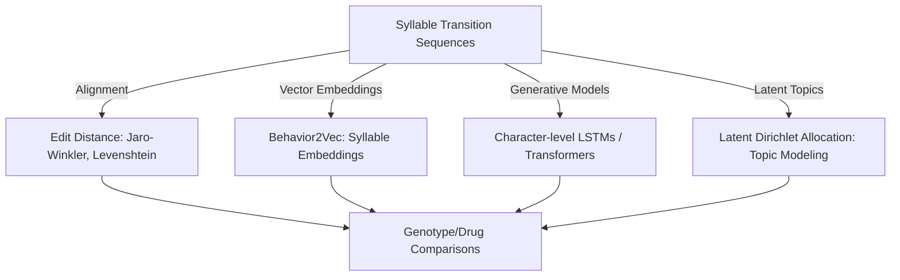
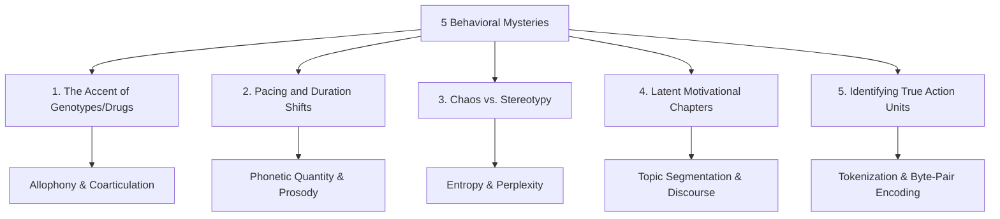

# Brainstorming: Applying Natural Language Processing (NLP) to Behavioral Grammar

This document outlines conceptual and mathematical frameworks that map behavioral syllables (from Keypoint MoSeq) to language processing models. It explores how we can move beyond rigid n-grams (which suffer from exponential sparsity as $N$ increases) to represent, compare, and model mouse behavior as a language.

---

## 1. The Linguistic Analogy of Behavior

To apply NLP techniques, we must map behavioral features to linguistic constructs:

| Linguistic Element | Behavioral Equivalent | Biological/Computational Meaning |
| :--- | :--- | :--- |
| **Phoneme** (basic unit of sound) | Continuous pose kinematics (velocities, angles) | Sub-syllabic kinematics within a single frame or 50ms window. |
| **Syllable** | MoSeq Syllable ID (e.g. `12`) | Discrete pose-state resulting from clustering keypoint trajectories. |
| **Word / Morpheme** | Collapsed Syllable / Transition Chunk | A stable semantic block (e.g., `walk -> rear -> look`). |
| **Sentence** | Behavioral Bout | A continuous sequence of active syllables, typically bounded by rest, grooming, or long stationary pauses. |
| **Grammar / Syntax** | Transition Probability Constraints | The biological rules (enforced by striatal circuits) governing what sequence transitions are permissible. |
| **Dialect / Accent** | Genotype-specific sequence variations | How WT vs. DAT-KI mice execute the same behavioral intention (e.g., different micro-kinematics or transition preferences). |
| **Semantics** | Behavioral State / Goal (e.g. Exploration vs. Escape) | The latent motivation driving the choice of behavioral sentences. |

---

## 2. Overcoming the N-gram Sparsity Problem

As we transition to 4-grams, 5-grams, and higher, the number of potential combinations scales as $V^N$ (where $V$ is vocabulary size). With 20 MoSeq syllables:
* $20^3 = 8,000$ possible trigrams
* $20^4 = 160,000$ possible 4-grams
* $20^5 = 3,200,000$ possible 5-grams

Since a typical mouse session contains only a few thousand transitions, most high-order cells are zero. Rather than relying on exact string counts, we can borrow modern NLP architectures to represent behavior continuously.

---

## 3. Five Concrete Brainstorming Ideas

### Idea A: "Behavior2Vec" (Syllable Contextual Embeddings)
* **Concept**: In language, words that appear in similar contexts have similar meaning (*"you shall know a word by the company it keeps"*). We can train a Word2Vec model (Skip-gram or Continuous Bag of Words) using behavioral sequences from all sessions.
* **Implementation**:
  * Treat each session's sequence of collapsed syllables as a sentence: `["walk", "right_turn", "walk", "rear", "groom"]`.
  * Train a Word2Vec or FastText model to map each syllable to a low-dimensional vector space (e.g., $\mathbb{R}^8$ or $\mathbb{R}^{16}$).
  * Measure cosine similarity between syllables.
* **Genotype/Drug Hypothesis**: 
  * Under Amphetamine, does the semantic similarity between investigate-type syllables (e.g., `rear`, `sniff`) and locomotor syllables (e.g., `walk`, `run`) change?
  * We can train separate embeddings for WT and KI mice. If `rear` maps to a very different vector space region in KI mice than in WT mice, it implies `rear` is being used in a structurally different "syntactic" context (i.e., its behavioral meaning has shifted).

### Idea B: Sentence Similarity (Levenshtein / Edit Distance)
* **Concept**: In text processing, Edit Distance (or Needleman-Wunsch sequence alignment) measures how many insertions, deletions, or substitutions are needed to turn one sequence into another.
* **Implementation**:
  * Segment behavior into "sentences" (e.g., sequences of active syllables delimited by a `stop` or `rest` syllable of duration $>1.0$s).
  * Compute the pairwise Jaro-Winkler or Levenshtein distance between sentences.
  * Construct a distance matrix of all behavioral sentences.
* **Genotype/Drug Hypothesis**:
  * Do DAT-KI mice execute "typos" or spelling variations of normal WT behavioral sequences?
  * We can compute the intra-group sentence similarity (are WT sequences highly stereotyped?) vs. inter-group similarity (do KI sequences diverge from WT sequences by simple mutations or are they completely random?).

### Idea C: Perplexity as a Measure of Behavioral Disruption
* **Concept**: In NLP, the performance of a language model is evaluated using **perplexity**—a measure of how surprised the model is by a test sequence.
* **Implementation**:
  * Train a character-level recurrent neural network (LSTM) or a micro-GPT model on WT-Saline syllable sequences to learn the baseline "rules of behavioral grammar."
  * Feed sequences from WT-AMPH, KI-Saline, and KI-AMPH into the model and calculate the average cross-entropy loss or perplexity.
* **Genotype/Drug Hypothesis**:
  * Perplexity will quantify "grammatical degradation."
  * We expect WT-AMPH to exhibit high perplexity (hyper-locomotion breaks normal rules).
  * In KI baseline mice, is the perplexity higher than WT baseline? Does AMPH rescue perplexity in KI mice (mirroring the paradoxical restorative effect we saw in the temporal saliency analysis)?

### Idea D: Topic Modeling (LDA - Latent Dirichlet Allocation)
* **Concept**: Topic modeling (like Latent Dirichlet Allocation) treats documents as mixtures of topics, and topics as mixtures of words.
* **Implementation**:
  * Treat each mouse session as a "document."
  * Generate a "vocabulary" consisting of short behavioral motifs (e.g., all observed 3-grams and 4-grams).
  * Train an LDA model to discover 5–10 latent "behavioral topics" (e.g., Topic 1: *Investigative Rearing*, Topic 2: *Stereotyped Grooming*, Topic 3: *Hyper-locomotor Escaping*).
* **Genotype/Drug Hypothesis**:
  * Instead of evaluating individual n-grams, we can evaluate each mouse's "topic distribution."
  * This allows us to say: *"Amphetamine shifts the KI topic mixture from Topic 4 (rearing/investigation) to Topic 2 (stereotyped turning), whereas WT shifts to Topic 3 (sustained forward running)."*

### Idea E: Sequence-to-Sequence Generative Grammar (The "Translational" Model)
* **Concept**: Can we translate a sequence of behaviors from a "KI mouse dialect" to a "WT mouse dialect"?
* **Implementation**:
  * Train an encoder-decoder network (or a small attention-based sequence-to-sequence model).
  * The network is trained on sessions where mice are matched in environmental state (e.g., exploring the center of the open field) to translate sequences from one genotype's style to the other.
  * Alternatively, we can use the **neural photometry signals (dLight)** as an attention mask to modulate sequence generation, testing if striatal dopamine fluctuations acts as the "prompt" that generates behavioral words.

---

## 4. Bridging the Gap: Integrating the Continuous Postural Representation

Each discrete syllable is constructed by segmenting continuous postural sequences—represented by $10$ orthogonal PCA dimensions (e.g., `latent_state_0` to `latent_state_9`)—using an Autoregressive Hidden Markov Model (AR-HMM). This is the behavioral equivalent of the **acoustic-to-phonetic conversion** in speech recognition:

$$\text{Continuous Pose Space } (X(t) \in \mathbb{R}^{10}) \xrightarrow{\text{AR-HMM Segmentation}} \text{Discrete Syllables } (S_t \in \{1..20\})$$

By integrating this continuous postural space into our NLP-inspired models, we can construct richer, physically grounded metrics:

### A. Posturally Grounded "Phonetic" Embeddings
* **Method**: Instead of initializing syllable vectors randomly (as in standard Word2Vec), initialize the base vector for syllable $i$ using the mean trajectory $\bar{X}_i \in \mathbb{R}^{10 \times T_i}$ of its postural PCA coordinates (and velocities).
* **Benefit**: The embedding space is constrained by physical posture. Cosine similarity between syllable embeddings will represent both semantic context similarity (how they are chained) and physical pose similarity (how alike they look).

### B. Dynamic Time Warping (DTW) on Continuous Sentences
* **Method**: Define a behavioral "sentence" as the concatenated 10-dimensional PCA trajectory of a sequence of active syllables. Compare two sentences using **Dynamic Time Warping (DTW)** on the continuous $\mathbb{R}^{10}$ space.
* **Benefit**: We can directly test if different genotypes or drug conditions execute the *exact same* grammatical sequence (e.g., `walk -> turn -> rear`) with a different "accent" (physical velocity/pose trajectory).

### C. Continuous Autoregressive Pose Modeling (Continuous GPT)
* **Method**: Train a decoder-only neural network (e.g., a simple Transformer or LSTM) to perform autoregressive forecasting directly on the continuous PCA coordinates, predicting $X(t+1)$ given the historical window $X(t-k:t)$.
* **Benefit**: The model learns the continuous transition grammar. The forecasting loss (analogous to perplexity) can quantify how much a drug or genotype alters the smooth, physical dynamics of movement, capturing variations that discrete n-grams miss.

---

## 5. Next Steps: A Practical Proof of Concept

If we want to build a small demonstration of this, we could write a script that:
1. Translates syllables into an alphabet string (e.g. `walk = A, turn = B, rear = C`).
2. Extracts sentences bounded by rest/stops.
3. Implements **Behavior2Vec** using `gensim.models.Word2Vec` (if installed) or a simple NumPy-based skip-gram helper.
4. Computes Levenshtein edit distance between genotype groups to see if the sentence structure is statistically distinct.
5. Performs **Dynamic Time Warping (DTW)** on the PCA latent trajectories (`latent_state_0` through `latent_state_9`) to measure the physical divergence (the "motor accent") when executing identical syllable sequences.

---

## 6. The Five Behavioral Mysteries & Linguistic Parallels

Below are five core mysteries of mouse open-field behavior, paired with established concepts in linguistics and speech processing that provide mathematical and analytical solutions:

### Mystery 1: The "Accent" of Genotypes / Drug Perturbations
* **Behavioral Mystery**: WT and KI mice might both execute a `right turn`. Under Saline, it is a smooth pivot. Under Amphetamine, it might be a sharp, jerky turn. Both are discretized into the exact same syllable, but their physical execution is distinct. How do we quantify these fine-grained structural variations of a single behavioral unit across groups?
* **Linguistic/Phonetic Parallel: Allophony & Coarticulation**:
  * In phonology, a **phoneme** (like /p/) is an abstract category, but its actual acoustic realization—its **allophones** (like the aspirated [pʰ] in "pin" vs. the unaspirated [p] in "spin")—changes based on speaker context. Additionally, **coarticulation** describes how adjacent sounds blend (e.g., how the posture of `turn` is modified by whether it followed `walk` or `rear`).
  * **Solution**: Model the continuous PCA trajectories (the "soundwave") associated with each discrete syllable. By computing the variance of these trajectories around the average syllable centroid, we can quantify the precise "allophonic accent" and "coarticulatory shift" induced by the KI genotype or Amphetamine.

### Mystery 2: Behavioral "Syllable Lengthening" and Pacing
* **Behavioral Mystery**: Under Amphetamine, some syllables (like forward locomotion) become extremely prolonged, while other states (like grooming or resting) are cut short or skipped entirely. How do we quantify changes in the rhythmic pacing, duration, and stress patterns of behavioral bouts without losing the sequence structure?
* **Linguistic/Phonetic Parallel: Phonetic Quantity & Prosody**:
  * In linguistics, **quantity** refers to the contrastive use of sound duration (short vs. long vowels). **Prosody** encompasses the rhythm, stress, and intonation of language.
  * **Solution**: Perform prosodic analysis on behavior. Treat syllables as having rhythmic stress (high-intensity motor states) and unstressed states (low-intensity pause/rest states). We can measure the duration ratio of "vocalic" states (sustained postures) vs. "consonantal" states (rapid transitions) to compile a rhythmic profile (analogous to stress-timed vs. syllable-timed language rhythm) for each animal group.

### Mystery 3: Syntactic Chaos vs. Stereotypy (Grammar Degradation)
* **Behavioral Mystery**: Does Amphetamine or the DAT-KI mutation make behavior genuinely random (chaotic sequence transitions), or does it force the mouse into highly repetitive, narrow loops (restricted grammar)? How do we mathematically distinguish a mouse that is hyperactive but grammatical from one that is hyperactive and grammatically broken?
* **Linguistic/Phonetic Parallel: Information Entropy & Perplexity**:
  * In computational linguistics, the predictability of a sequence is measured by its **entropy** (uncertainty of the next word) and a language model's **perplexity** when reading it. Highly repetitive text (low entropy) is stereotyped; chaotic text (high entropy) has no grammar.
  * **Solution**: Train an n-gram language model with Kneser-Ney smoothing on WT-Saline baseline data. Calculate the perplexity of test sequences from other cohorts. If a cohort shows high perplexity, its transition grammar is degraded (syntactic chaos). If it shows very low perplexity, its behavior has collapsed into rigid stereotypy.

### Mystery 4: Latent Motivational Chapters (Long-term Behavioral Drift)
* **Behavioral Mystery**: In an open field, a mouse shifts between macro-behaviors over minutes: initial exploration of the boundary (thigmotaxis), followed by center exploration, grooming, and finally rest. These represent hidden motivational states. How do we segment a long behavioral session into distinct, coherent "chapters" or "paragraphs" of behavioral discourse?
* **Linguistic/Phonetic Parallel: Topic Segmentation & Discourse Analysis**:
  * In NLP, long texts are divided into thematic sections using **Topic Segmentation** algorithms (e.g., TextTiling or Hidden Markov Models on word distributions).
  * **Solution**: Apply **TextTiling** or **Topic Modeling (LDA)** on sliding windows of behavioral n-grams. By representing each window as a "paragraph," we can identify the exact boundaries where a mouse transitions from an "investigative" discourse to a "grooming/rest" discourse, comparing discourse length and frequency between genotypes.

### Mystery 5: Behavioral "Words" and Chunking (Morpheme Extraction)
* **Behavioral Mystery**: Syllables do not occur in isolation; they are grouped into functional chunks (e.g., `rear -> sniff -> look` is a single functional unit of checking the wall). What are the true "words" of mouse behavior, and how do we discover them without manual labeling?
* **Linguistic/Phonetic Parallel: Word Segmentation / Byte-Pair Encoding (BPE)**:
  * In languages written without spaces (like Chinese or Japanese) or when processing raw characters, NLP models use **Byte-Pair Encoding (BPE)** or **WordPiece** tokenization to find recurring character chunks based on statistical association.
  * **Solution**: Run the **BPE** algorithm on the discrete syllable stream. BPE starts with individual syllables (characters) and iteratively merges the most frequent adjacent pairs. By analyzing the vocabulary of behavioral "words" generated for WT and KI mice, we can identify if they share the same vocabulary or if they compile their behaviors into entirely different syntactic chunks.
