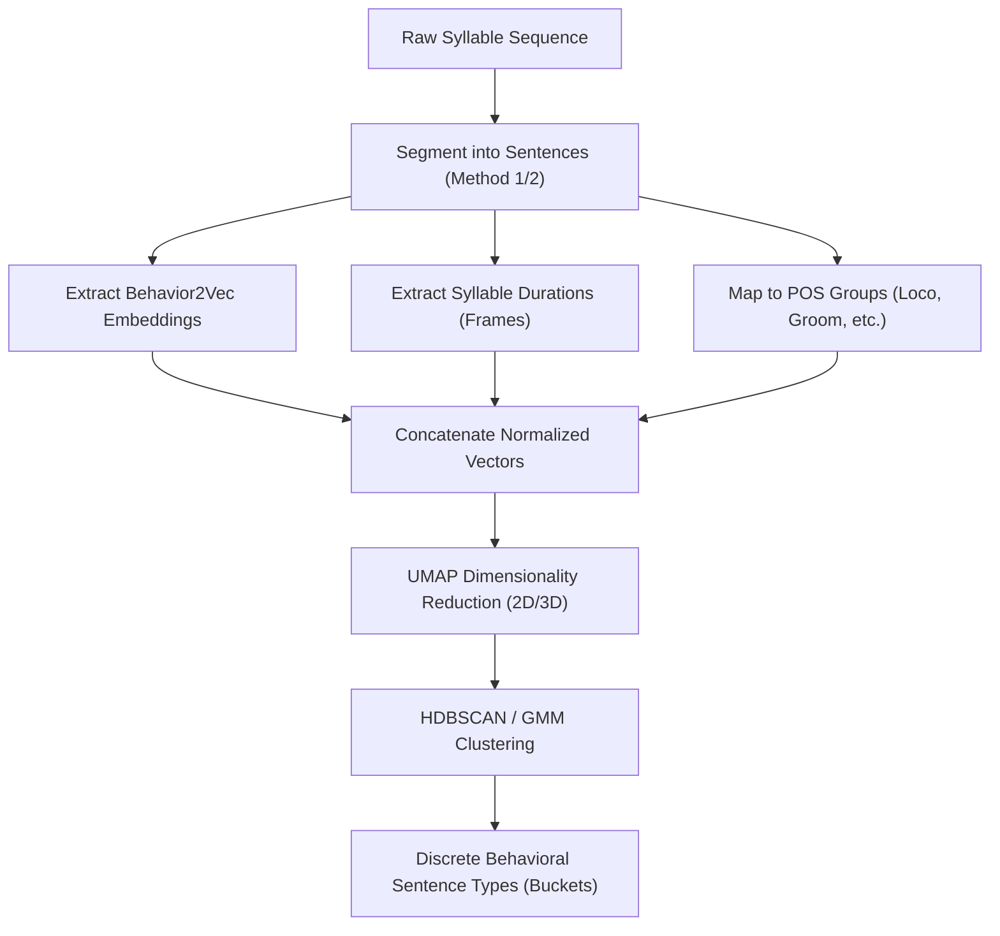

# Ideas from Chatbot: Unsupervised Behavioral Sentence Clustering

This document summarizes the ideas discussed regarding unsupervised sentence discretization in natural language processing (NLP) and documents the translation of those ideas to the **MoSeq Behavioral Language Modeling** codebase.

---

## 1. The Core NLP Concept (As Desired)

Discretizing sentence types in an unsupervised manner can be achieved using a **stylometric and semantic clustering pipeline**. Each sentence is converted into a hybrid feature vector combining **semantics** (what is said) and **rhythm/structure** (how it is structured), followed by clustering to discover natural groups (e.g., short commands vs. long narratives).

$$\vec{x} = [\text{Semantic Embedding} \mid \text{Syllable Profile} \mid \text{POS Sequence Probabilities}]$$

---

## 2. Translation to MoSeq Behavioral Language

We can directly map every component of the NLP pipeline to our MoSeq behavioral syllable sequences:

| NLP Concept | Behavioral Language Equivalent | Codebase Implementation |
| :--- | :--- | :--- |
| **Text Document** | Entire Open Field Session | `Session` object (`all_data_df`) |
| **Words** | Behavioral Syllables | RLE collapsed syllable IDs (`collapsed_seq`) |
| **Sentences** | Segmented Syllable Sequences | Bouts segmented by Method 1 or Method 2 |
| **Semantic Meaning** | Behavior2Vec Embedding | Mean vector of the sentence's syllables using `Behavior2Vec` ([embeddings.py](file:///home/fsp585/Desktop/FiberphotometryCode/syllable_generation/analysis/language_models/lib/models/embeddings.py)) |
| **Word Syllables (Rhythm)** | Syllable Duration (Frames) | The sequence of physical durations in frames for each syllable in the sentence |
| **POS Tags (Syntax)** | Syllable Functional Groups | Broad behavioral groups: `Locomotion`, `Exploration/Rearing`, `Grooming`, `Idle` |
| **Sentence Types** | Behavioral Bout Topics | HDBSCAN/GMM clusters of the hybrid sentence vectors |

---

## 3. Proposed Feature Vector Construction for Behavior

To categorize entire behavioral sentences into discrete buckets, we construct a hybrid vector $\vec{x}$ for each sentence:

### A. Semantic Vector ($\vec{v}_{\text{semantic}}$)
We train the `Behavior2Vec` (Word2Vec) model on our syllable streams to learn a continuous $D$-dimensional representation of each syllable. For a sentence of length $L$ composed of syllables $S_1, S_2, \dots, S_L$:
$$\vec{v}_{\text{semantic}} = \frac{1}{L} \sum_{i=1}^{L} \text{Behavior2Vec}(S_i)$$

### B. Rhythmic Vector ($\vec{v}_{\text{rhythm}}$)
We extract the frame-level duration sequence of the syllables in the sentence. We can capture the tempo/pacing of the sequence by computing:
$$\vec{v}_{\text{rhythm}} = [\text{mean\_duration}, \text{std\_duration}, \text{max\_duration}, \text{tempo\_entropy}]$$

### C. Syntactic Vector ($\vec{v}_{\text{syntax}}$)
We map all syllable IDs to their functional categories (e.g. 1=Locomotion, 2=Exploring, 3=Grooming, 4=Immobile). We then compute the frequency distribution of these groups inside the sentence, which acts as a Part-of-Speech tag signature:
$$\vec{v}_{\text{syntax}} = [P(\text{Locomotion}), P(\text{Exploration}), P(\text{Grooming}), P(\text{Immobile})]$$

---

## 4. Unsupervised Clustering & Discretization Workflow

1. **Concatenation**: Combine all features into $\vec{x} = [\vec{v}_{\text{semantic}} \mid \vec{v}_{\text{rhythm}} \mid \vec{v}_{\text{syntax}}]$.
2. **Normalization**: Apply standard Z-score scaling.
3. **Dimensionality Reduction**: Project features to a 2D/3D space using **UMAP**.
4. **Clustering**: Run **HDBSCAN** or **Gaussian Mixture Models (GMM)** to group sequences into $K$ discrete behavioral topics (e.g., fast active running, local scanning, slow head grooming).

---

## 5. Downstream WT vs. KI Analyses

Once we have mapped each sentence to a discrete "Sentence Type" ID, we can perform the following comparative analyses:
1. **Bout Topic Abundance**: Compare the frequency of each sentence type between WT and KI baseline conditions (e.g. do KI mice spend significantly more time in "hesitant exploratory bails"?).
2. **Sentence Grammar Syntax**: Construct a Markov transition matrix between sentence types to see if WT and KI sequence their behavioral concepts differently.
3. **Fiberphotometry Integration**: Correlate dopamine (DA) signal transitions with transitions between specific behavioral sentence types.
