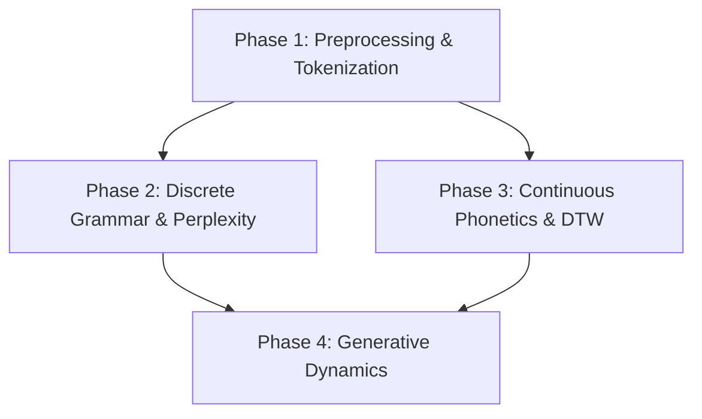

# Overarching Implementation Plan: NLP Behavioral Analysis Framework

This document outlines the strategic roadmap for attacking each research question and method proposed in the behavioral NLP framework. It structures the implementation into four sequential, cumulative phases, defining inputs, algorithms, and expected analytical outcomes.

---

---

## Phase 1: Core Preprocessing & Tokenization (The Foundation)

Before building language models, we must convert continuous frame-by-frame data into clean linguistic sequences.

### A. RLE Collapsing & Sequence Chunking
* **Attack Strategy**:
  1. Standardize consecutive duplicated frames into single transition nodes (e.g. `[walk, walk, walk, rear] -> [walk, rear]`).
  2. Slice the continuous transition stream into sentences using **Method 1 (Slow Syllable Slicing)**. The boundary syllables are discovered programmatically by ranking the syllables by their mean velocity across the dataset and selecting the bottom $P$-th percentile. 
  3. *Note*: Method 2 (Kinematic Idleness Slicing) was empirically evaluated and retired because Method 1 achieved significantly higher classification separation between WT/KI genotypes and better sequence compression.
* **Target Modules**: `lib/preprocessing/rle.py`, `lib/preprocessing/segmentation.py`

### B. Byte-Pair Encoding (BPE) Word Tokenization
* **Attack Strategy**:
  1. Train a BPE tokenizer on WT Saline baseline bouts to merge high-frequency adjacent syllables (e.g. `[rear, turn]` $\rightarrow$ `[rear-turn]`).
  2. Build a behavioral vocabulary showing which syllable chunks form the stable "words" of mouse exploration.
  3. Tokenize all sessions' sentences using this vocabulary.
* **Target Modules**: `lib/preprocessing/tokenization.py`

---

## Phase 2: Discrete Grammar, Perplexity & Discourse (The Syntactic Layer)

Once we have discrete tokens, we analyze sequence grammar and predictability using statistical NLP tools.

### A. Perplexity & Syntactic Entropy
* **Attack Strategy**:
  1. Fit an N-gram model (with Kneser-Ney smoothing) or a simple LSTM on WT Saline sequences to learn baseline syntactic rules.
  2. Evaluate test sequences from WT-AMPH, KI-Saline, and KI-AMPH.
  3. Compare perplexity levels. Highly stereotyped sequences will show extremely low perplexity; chaotic sequences will show high perplexity.
* **Target Modules**: `lib/models/discrete.py`, `lib/evaluation/metrics.py`

### B. Latent Topic Modeling (LDA)
* **Attack Strategy**:
  1. Treat each mouse session as a document and sliding windows of 4-gram motifs as words.
  2. Apply Latent Dirichlet Allocation (LDA) to extract 5–10 latent "behavioral topics" (e.g., investigative rearing, hyperactive locomotor loops, micro-grooming).
  3. Track topic proportions across animal cohorts to profile the behavioral discourse.
* **Target Modules**: `lib/visualization/metrics_viz.py`

---

## Phase 3: Continuous Phonetics, Alignments & Embeddings (The Acoustic Layer)

This phase integrates the continuous 10D PCA postural trajectories (`latent_state_0` to `latent_state_9`) to analyze how behavioral intentions are physically executed.

### A. Dynamic Time Warping (DTW) "Accent" Alignment
* **Attack Strategy**:
  1. Group sessions by cohort (WT/KI, Saline/AMPH).
  2. For a specific behavioral sentence (e.g. a BPE-merged word like `walk -> turn -> rear`), gather its raw 10D PCA postural frames from all matching instances.
  3. Run multi-dimensional DTW on the raw PCA trajectories of WT vs. KI cohorts to calculate the physical alignment distance.
  4. Compare the variance to quantify the physical "accent" changes under Amphetamine or genotype mutations.
* **Target Modules**: `lib/evaluation/dtw.py`

### B. Posturally Grounded Syllable Embeddings (Behavior2Vec)
* **Attack Strategy**:
  1. Compute the average 10D PCA coordinate and velocity vector for each of the 20 syllables to serve as their static "phonetic" layout.
  2. Initialize the Word2Vec skip-gram weight matrix with these PCA coordinates.
  3. Optimize vectors using transition contexts to create joint semantic-postural embeddings.
* **Target Modules**: `lib/models/embeddings.py`, `lib/visualization/embedding_viz.py`

---

## Phase 4: Generative Dynamics (Autoregressive Trajectories)

This phase trains generative models to predict upcoming behavior and quantify physical dynamical error.

### A. Continuous Autoregressive Pose Modeling (Continuous GPT)
* **Attack Strategy**:
  1. Feed continuous 10D PCA postural trajectories into an LSTM or a micro-Transformer forecasting model.
  2. Train the model to forecast $X(t+1) \in \mathbb{R}^{10}$ given history $X(t-k:t)$.
  3. Measure the forecasting error (mean squared error or cross-entropy) across test groups to quantify transition dynamics disruption.
* **Target Modules**: `lib/models/continuous.py`

---

## Verification & Iteration Protocol

1. **Synthetic Validation**: Generate synthetic Markov random-walk syllable sequences and verify that the metrics register maximum perplexity (entropy) and fail DTW checks.
2. **Modular Test Runs**: Run each phase sequentially on a single session's data subset to ensure parameters compute fast before scaling up.

---

## 7. Assumptions, Failure Modes, and Back-off Strategies

To keep models as simple and interpretable as possible, we identify the underlying assumptions for each technique, assess if they are too brash, and define simpler fallback solutions.

| Technique | Underlying Assumption | Why It Might Fail (Failure Mode) | Fallback / Back-off Solution (Keep It Simple) |
| :--- | :--- | :--- | :--- |
| **RLE Collapsing** | Saccadic transitions matter; frame duration is secondary noise. | Drug perturbations or mutations primarily alter *state duration* rather than transition order. | Model transitions as a continuous-time Markov process, or keep repetition counts as a separate duration feature. |
| **BPE Word Tokenization** | Mice build stereotyped sequences (behavioral words). | Behavior is too variable, leading to noisy and ungeneralizable chunk combinations. | Abandon hierarchical BPE; analyze raw bigrams or compute Shannon transition matrix entropy directly. |
| **Behavior2Vec (Embeddings)** | Context determines a state's "meaning." | The transition network is dominated by a few high-frequency states, causing embedding collapse. | Fall back to raw transition probabilities or low-dimensional PCA of the transition matrix. |
| **Perplexity (Language Models)** | Syntax is stationary and has higher-order dependencies. | Sequence patterns drift throughout a session or vary too much from mouse to mouse. | Use a simple 1st-order Markov transition matrix (bigrams) and compare matrix cross-entropy directly. |
| **Topic Modeling (LDA)** | Sessions consist of thematic mixtures of motifs. | Behavior is uniform, leading to broad, overlapping topics. | Classify sessions using simple K-means or UMAP clustering on unigram/bigram profiles. |
| **Continuous DTW & Pose Forecasting** | PCA trajectories represent a predictable, low-noise pose space. | PCA space is highly non-linear or noisy, yielding high forecasting error. | Back off to simple kinematic averages (e.g. speed, acceleration) associated with each syllable. |
