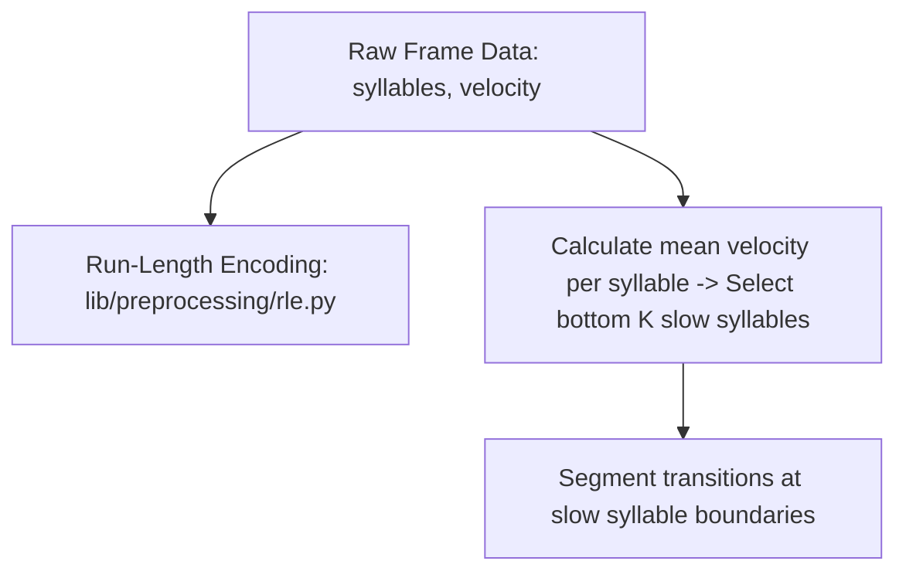

# Implementation Plan: Phase 1.a — RLE Collapsing & Sequence Chunking

This document outlines the detailed implementation strategy for **Phase 1.a (Sequence Preprocessing and Sentence Segmentation)**. The goal is to define sequence boundaries (sentences/bouts) using data-driven, assumption-free kinematic features rather than manually naming syllables.

---

## Proposed Segmentation Methods

Following empirical hyperparameter optimization sweeps, we evaluated two distinct segmentation mechanisms. Based on the optimization metrics (where Method 1 achieved 93.3% genotype decodability and 42.8% compression vs. Method 2's 83.3% decodability and 29.8% compression), **Method 2 (Kinematic Idleness) has been retired**. 

From now on, the pipeline exclusively uses **Method 1 (Slow Syllable Slicing)** to segment sentences.

### Method 1: Low-Velocity Syllable Detection (Exclusive Boundary Slicing Rule)
Instead of manually naming "rest" or "stop" syllables, we programmatically discover which syllables represent idle states.
* **Algorithm**:
  1. Compute the global average of `velocity_px_s` (centroid velocity) for every syllable ID across the dataset.
  2. Rank syllables by mean velocity and select the bottom $K$ slowest syllables (defined by the bottom $P$-th percentile of overall syllable velocity).
  3. Treat these programmatically discovered slow syllables as boundary tokens (periods/punctuation).
  4. Segment the collapsed RLE transition streams around these boundary tokens.
* **Tunable Parameter**:
  * `percentile` ($P$): The percentile cutoff of sorted syllable mean velocities used to dynamically define the set of boundary punctuation syllables. Optimized via log-scale Bayesian Optimization.

---

## How We Measure "Rightness" (Validation Metrics)

To discover the optimal values for these hyperparameters and verify that our behavioral segmentation is physically and biologically meaningful (rather than a random split), we will evaluate the following metrics across parameter sweeps:

### A. Phenotypic Class Separation (Decodability)
* **Rationale**: If a segmentation is biologically meaningful, the resulting sentence distributions should maximize our ability to distinguish different groups.
* **Test**: Train a classifier (e.g., Random Forest) to predict Genotype (WT vs. KI) or Drug (Saline vs. AMPH) using only the sentence-frequency profile of each session.
* **Rightness Metric**: The optimal hyperparameter value is the one that **maximizes classification accuracy**. If a parameter splits behavior too finely or too coarsely, decodability will collapse to chance.

### B. Dopamine Transient Alignment (dLight PETH Variance)
* **Rationale**: True behavioral transition boundaries are often marked by sharp changes in striatal dopamine levels.
* **Test**: Compute the Peri-Event Time Histogram (PETH) of the z-scored dLight photometry signal aligned to the discovered sentence boundaries.
* **Rightness Metric**: The optimal parameters are those that **maximize the peak variance or signal-to-noise ratio (SNR)** of dopamine transients surrounding sentence boundaries. Random boundaries will wash out to a flat PETH.

### C. Sequence Compression Efficiency (Minimum Description Length)
* **Rationale**: In NLP, the optimal vocabulary and tokenization maximize sequence compression.
* **Test**: For a given segmentation, train the BPE tokenizer and compute the sequence compression ratio (how much BPE reduces the sequence length).
* **Rightness Metric**: Optimize the joint entropy and codebook length using the Minimum Description Length (MDL) principle to avoid over-segmenting.

---

## Proposed Changes

We will implement these methods inside the `preprocessing` subfolder:

### 1. Preprocessing Modules
* **[rle.py](file:///home/fsp585/Desktop/FiberphotometryCode/syllable_generation/analysis/language_models/lib/preprocessing/rle.py)**:
  * Exposes `collapse_transitions(session)` to collapse identical sequential frames.
* **[segmentation.py](file:///home/fsp585/Desktop/FiberphotometryCode/syllable_generation/analysis/language_models/lib/preprocessing/segmentation.py)**:
  * `discover_slow_syllables(sessions, percentile=0.15)`: Finds the IDs of the slowest syllables across sessions.
  * `segment_by_slow_syllables(collapsed_seq, slow_syll_ids)`: Implements Method 1.
  * `segment_by_kinematic_idleness(session, idle_vel=5.0, min_duration=80)`: Implements Method 2.

---

## Verification Plan

We will write a verification test in `run_lm_analysis.py` to:
1. Ensure both Method 1 and Method 2 generate valid list-of-list sequences (sentences).
2. Validate that changing the hyperparameters (`idle_velocity_threshold` or `slow_syllable_count`) correctly shifts the average sentence length, demonstrating control over the segmentation resolution.
