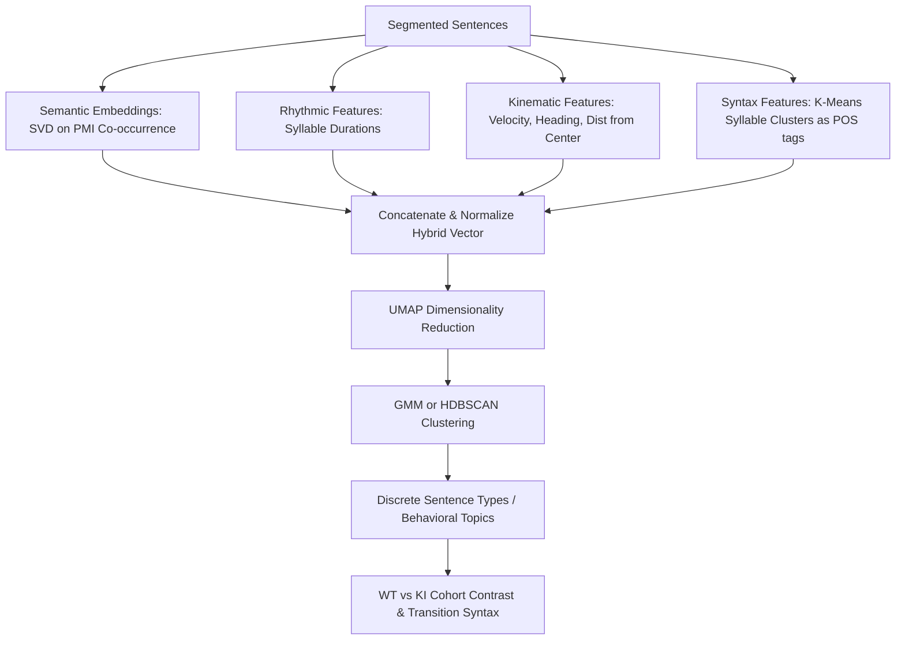

# Implementation Plan: Phase 1.b — Unsupervised Behavioral Sentence Clustering

This document outlines the detailed implementation strategy for **Phase 1.b (Unsupervised Behavioral Sentence Clustering)**. The goal is to cluster our segmented behavioral sentences into discrete "Sentence Types" (behavioral topics) using a hybrid feature representation combining transition semantics, syntax, rhythm, and kinematics.

---

## Proposed Pipeline Workflow



---

## 1. Feature Engineering: Hybrid Sentence Vectors

For each segmented sentence (sequence of collapsed RLE syllable IDs and their associated frame durations/kinematics), we construct a hybrid feature vector:

$$\vec{x} = [\vec{v}_{\text{semantic}} \mid \vec{v}_{\text{syntax}} \mid \vec{v}_{\text{rhythm}} \mid \vec{v}_{\text{kinematic}}]$$

### A. Semantic Vector ($\vec{v}_{\text{semantic}}$)
Since `gensim` is not installed, we implement a stable, deterministic SVD-based co-occurrence factorization in [embeddings.py](file:///home/fsp585/Desktop/FiberphotometryCode/syllable_generation/analysis/language_models/lib/models/embeddings.py):
1. **Co-occurrence Matrix**: Build a transition co-occurrence matrix $C$ of size $V \times V$ from all sentences.
2. **PMI Matrix**: Calculate the Pointwise Mutual Information (PMI) matrix:
   $$PMI(i, j) = \max\left(0, \log\left(\frac{P(i, j) \cdot N}{P(i) P(j)}\right)\right)$$
3. **SVD Embeddings**: Factorize using Singular Value Decomposition ($PMI = U \Sigma V^T$) to get $D$-dimensional syllable embeddings ($W = U_D \Sigma_D^{0.5}$, default $D = 16$).
4. **Sentence Average**: The semantic vector $\vec{v}_{\text{semantic}}$ is the mean embedding vector of the syllables in the sentence.

### B. Syntactic Vector ($\vec{v}_{\text{syntax}}$)
To define Part-of-Speech (POS) syntax categories in a data-driven, unsupervised manner:
1. Run **K-Means** on the 16-dimensional syllable embeddings to cluster all $V$ syllables into $G = 5$ functional groups.
2. For each sentence, compute the probability distribution (histogram) of functional groups across its syllables. This 5-dimensional vector represents $\vec{v}_{\text{syntax}}$.

### C. Rhythmic Vector ($\vec{v}_{\text{rhythm}}$)
Extract frame durations for each syllable in the sentence to capture its temporal pacing:
$$\vec{v}_{\text{rhythm}} = [\text{mean\_dur}, \text{std\_dur}, \text{max\_dur}, \text{entropy\_dur}]$$

### D. Kinematic Vector ($\vec{v}_{\text{kinematic}}$)
Summarize frame-level kinematic properties of the sentence from `all_data_df` using absolute indices:
$$\vec{v}_{\text{kinematic}} = [\text{mean\_vel}, \text{std\_vel}, \text{mean\_ang\_vel}, \text{std\_ang\_vel}, \text{mean\_center\_dist}]$$

---

## 2. Dimensionality Reduction & Clustering

1. **Z-Score Normalization**: Standardize the hybrid features across all sentences.
2. **UMAP Projection**: Reduce the high-dimensional hybrid space down to 2 dimensions using `umap-learn` (available in the `kpms_gpu_cuml` environment).
3. **Clustering**: Apply **Gaussian Mixture Models (GMM)** or **HDBSCAN** to group the 2D coordinates into $K$ discrete **Sentence Types (Bout Topics)**. We will use Silhouette score or BIC to select the optimal number of topics (default $K = 6$ to $10$).

---

## 3. Proposed Changes

### Preprocessing and Models
We will create a clustering module to orchestrate the pipeline:

#### [NEW] [clustering.py](file:///home/fsp585/Desktop/FiberphotometryCode/syllable_generation/analysis/language_models/lib/preprocessing/clustering.py)
* `build_hybrid_features(sessions, punctuation_pkl_path, embedding_dim=16, n_groups=5)`:
  * Load punctuation frames and extract segmented sentences.
  * Train SVD co-occurrence embeddings.
  * Apply K-Means functional grouping.
  * Extract rhythmic and kinematic features.
  * Return a DataFrame of sentence-level features and metadata.
* `cluster_sentences(feature_df, n_clusters=8)`:
  * Apply Z-score normalization.
  * Project to 2D UMAP space.
  * Fit GMM to assign each sentence to a topic ID.
  * Return the UMAP coordinates and assigned cluster labels.

#### [MODIFY] [embeddings.py](file:///home/fsp585/Desktop/FiberphotometryCode/syllable_generation/analysis/language_models/lib/models/embeddings.py)
* Update `Behavior2Vec` to implement the SVD-based co-occurrence factorization logic in `fit()`.

---

### Visualization and Execution

#### [NEW] [plot_clustering.py](file:///home/fsp585/Desktop/FiberphotometryCode/syllable_generation/analysis/language_models/lib/visualization/plot_clustering.py)
* `plot_sentence_umap(umap_coords, labels, score_df, save_path)`: Scatter plot of sentences in UMAP space, colored by their assigned topic ID.
* `plot_topic_proportions(feature_df, save_path)`: Bar chart comparing the abundance of each topic type between WT and KI mice.

#### [NEW] [run_phase_1b.py](file:///home/fsp585/Desktop/FiberphotometryCode/syllable_generation/analysis/language_models/run_phase_1b.py)
Orchestration CLI script:
1. Load IFDN and AMPH sessions.
2. Load their respective optimal punctuation configuration pickles.
3. Construct hybrid features and run unsupervised clustering on the baseline saline phase.
4. Log clustering plots, silhouette metrics, and WT vs. KI topic distributions directly to W&B.
5. Save the final clustered sentence metadata as `ifdn_clustered_sentences.pkl` and `amph_clustered_sentences.pkl`.

---

## Open Questions

> [%IMPORTANT]
> 1. **Joint or Separate Clustering Space**: Should we cluster IFDN and AMPH sentences in a single joint UMAP space, or build individual clustering models for each dataset? We propose building them **separately** since IFDN (home-cage) and AMPH (novel open-field arena + pharmacological state) contain distinct kinematic and exploratory profiles.
> 2. **Number of Clusters ($K$)**: We propose sweeping $K \in [5, 12]$ and using BIC/Silhouette scores to select the optimal number of topics, then locking the choice for downstream analysis.

---

## Verification Plan

### Automated Checks
* Run the pipeline script:
  ```bash
  /home/fsp585/miniforge3/envs/kpms_gpu_cuml/bin/python run_phase_1b.py
  ```
* Verify that:
  - UMAP and GMM run without dimensions errors.
  - Plots are generated under `output/`.
  - Pickle outputs are written with correct session keys and cluster labels.
