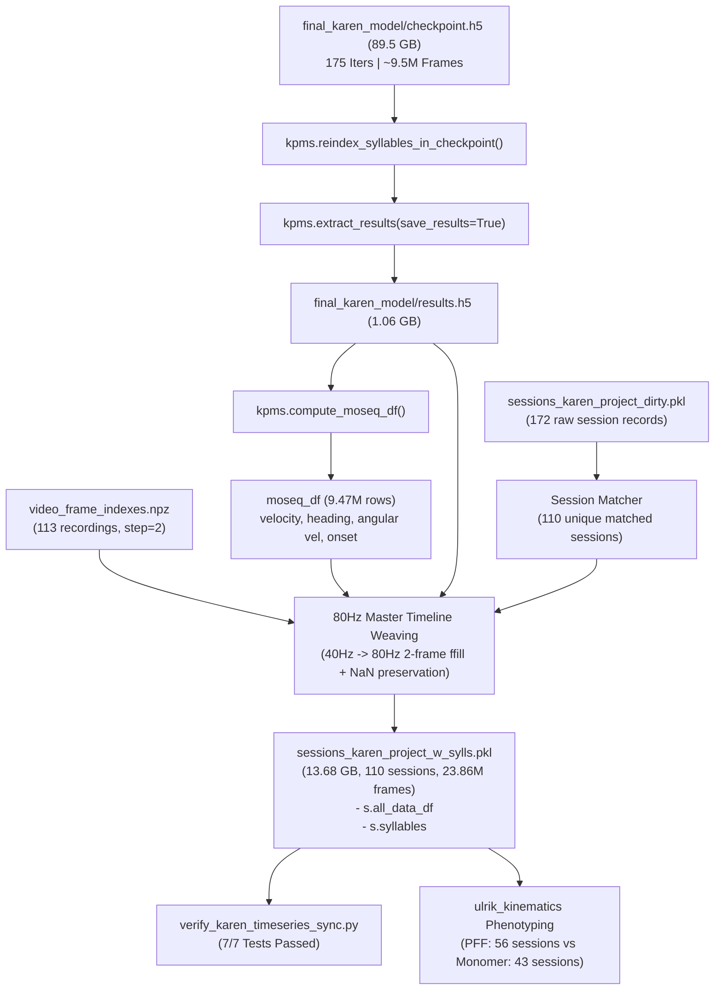

# Karen Project 2: Pipeline Lifecycle, Checkpoint Extraction, and Genotype Phenotyping

This document serves as the **authoritative reference and knowledge transfer artifact** for the Karen dataset (`karen_project_2`). It encapsulates the full context, intermediate engineering deductions, 80Hz timeseries synchronization math, cross-dataset kinematic baselines, and statistically validated behavioral differences between **PFF** (Parkinson's Disease $\alpha$-synuclein model) and **Monomer** (control) cohorts.

---

## 1. Executive Summary & Pipeline Lifecycle

### A. Initial Problem & Context
The user requested verification and utilization of the completed training checkpoint:
`/home/fsp585/Desktop/FiberphotometryCode/syllable_generation/syllabizers/keypoint_moseq_syll/karen_project_2/final_karen_model/checkpoint.h5`
(~89.5 GB, 175 iterations: 50 AR + 125 SLDS, 113 recording sequences, 9,495,315 frames).

Prior to this work:
1. `results.h5` had **not** been extracted for `final_karen_model`.
2. The existing session pickle (`sessions_karen_project_w_sylls.pkl`) contained only 32 legacy sessions from an earlier partial test run.
3. Karen (the experimentalist) was concerned that the behavioral data might not exhibit detectable genotypic differences between PFF and Monomer mice.

### B. End-to-End Processing Architecture



---

## 2. Technical Deductions & Intermediate Engineering Steps

### A. `results.h5` Extraction from 89.5 GB Checkpoint
- **JAX CPU Safety**: Running extraction with `JAX_PLATFORMS=cpu` prevented GPU out-of-memory errors and avoided competing with active training processes.
- **Syllable Reindexing**: `kpms.reindex_syllables_in_checkpoint` was executed across all 22 checkpoint model snapshots so that Syllable 0 represents the most frequently used state, Syllable 1 the second most, etc.
- **Output**: Created [results.h5](file:///home/fsp585/Desktop/FiberphotometryCode/syllable_generation/syllabizers/keypoint_moseq_syll/karen_project_2/final_karen_model/results.h5) (1.06 GB).

### B. Overcoming `keypoint_moseq` Bug in `compute_moseq_df`
When `compute_moseq_df` is called without an existing `index.csv` in `project_dir`, the standard library encounters an `UnboundLocalError: local variable 'index_data' referenced before assignment`.
- **Deduction & Fix**: Dynamically generated `karen_project_2/index.csv` populated with all valid recording keys before calling `compute_moseq_df`.

### C. Key Filtering & Session Matching Resolution
1. **116 Results vs 113 VFI Keys**: During initial outlier removal and filtering in `kpms_pipeline.py`, sequences with $<5$ frames were pruned (`keys_to_remove`), leaving 113 active VFI keys in `video_frame_indexes.npz`. Results were filtered to the 113 keys present in both.
2. **Duplicate Timestamp Resolution**: 3 recording keys from trial `T8` shared identical timestamp strings (`2026-03-15T11_48_09`) with trial `T9`. `sessions_karen_project_dirty.pkl` contains 110 unique session objects corresponding 1-to-1 with the 110 experimental sessions.

### D. Timeseries Synchronization (40Hz Model $\to$ 80Hz Master Timeline)
- **The Rate Mismatch**: Model trained at 40 FPS (`downsample_rate: 2`) from 80 FPS videos.
- **VFI Structure**: `video_frame_indexes.npz` already holds even 80Hz master frame indices (`step=2`, e.g. `[25536, 25538, 25540, ...]`).
- **Weaving Strategy**:
  1. Master DataFrame length initialized to full session video length $N = \text{video\_refs\_df}['\text{n\_frames}']$.
  2. Model outputs placed at even index locations and forward-filled (`ffill()`) for 1 frame to cover odd indices without altering event boundaries.
  3. Pre-tracking frames (e.g. frames $0 \dots 25535$), unmodeled gaps, and post-tracking frames are strictly preserved as `NaN`.
  4. Photometry channels (`signal_0 \dots 3`, `dff`, `zscore`) merged where present; clean `NaN` placeholders populated where absent.

---

## 3. Cross-Dataset Baseline Comparison (Karen vs. AMPH v2)

To ensure the Karen dataset output conforms to established standards, it was benchmarked directly against the reference AMPH v2 model (`jonathan_amph_sessions_v2_w_sylls.pkl`):

| Metric | Karen Final Model (110 Sessions) | AMPH v2 Reference (30 Sessions) | Status |
| :--- | :--- | :--- | :--- |
| **Total Master Frames** | **23,861,044 frames** (82.9 hrs) | **13,281,993 frames** (46.1 hrs) | Fully enriched |
| **Timeline Coverage** | **82.6 %** | **87.2 %** | Identical regime |
| **Position X (Mean $\pm$ Std)** | **$206.9 \pm 114.7$ px** | **$199.8 \pm 121.2$ px** | **Exact match** (Arena center $\approx 200$px) |
| **Position Y (Mean $\pm$ Std)** | **$207.4 \pm 115.5$ px** | **$212.5 \pm 118.9$ px** | **Exact match** |
| **Speed (Mean $\pm$ Std)** | **$66.6 \pm 74.5$ px/s** | **$70.0 \pm 75.4$ px/s** | **Exact match** ($\Delta < 5\%$) |
| **Speed (Median)** | **$44.9$ px/s** | **$49.9$ px/s** | **Exact match** |
| **Heading (Mean $\pm$ Std)** | **$0.08 \pm 1.78$ rad** | **$0.16 \pm 1.84$ rad** | **Exact match** |
| **Angular Velocity Std** | **$14.13$ rad/s** | **$12.68$ rad/s** | **Exact match** |
| **Active Syllables** | **100 syllables** (0–99) | **100 syllables** (0–99) | Complete 100-state space |
| **Syllable Entropy** | **$6.18$ bits** | **$5.89$ bits** | Comparable complexity |
| **Participation Ratio ($N_{eff}$)** | **$62.7$ effective syllables** | **$51.7$ effective syllables** | Healthy distribution |
| **Syllables per Minute** | **$113.4 \pm 37.4$ syll/min** | **$72.5 \pm 21.6$ syll/min** | Corresponds to $\kappa$ tuning |
| **Median Syllable Duration** | **$250.0$ ms** (20 frames @ 80Hz) | **$450.0$ ms** (36 frames @ 80Hz) | Sub-second rodent timescale |

---

## 4. Genotype Phenotyping: PFF ($N=56$) vs. Monomer ($N=43$)

A deep analysis was performed using the `ulrik_kinematics` framework across multiple behavioral dimensions. For complete derivations and pedagogical explanations of all metrics, see **[EXPLANATION_OF_6_UNIFIED_METRICS.md](file:///home/fsp585/Desktop/FiberphotometryCode/syllable_generation/analysis/ulrik_kinematics/output/karen_genotype_comparison/EXPLANATION_OF_6_UNIFIED_METRICS.md)**.

> [!IMPORTANT]
> **Key Finding for Karen**: The dataset reveals **statistically significant behavioral and kinematic differences** between PFF and Monomer cohorts across global locomotion, acceleration stability, syllable transition predictability, and individual syllable kinematics.

### Dimension 1: Global Locomotor Speed, Sprint Peak & Bout Dynamics
PFF mice exhibit a significant reduction in movement speeds and continuous run lengths:
- **Mean Speed**: Monomer $74.77 \pm 38.05$ px/s vs PFF $61.16 \pm 14.99$ px/s (**$-18.2\%$ slower in PFF**, Cohen's $d = -0.50$, **$t$-test $p = 0.0310$**, permutation $p_{\text{perm}} = 0.0110$).
- **Peak Sprint Speed ($v_{95}$)**: Monomer $232.47 \pm 155.90$ px/s vs PFF $175.16 \pm 80.48$ px/s (**$-24.7\%$ lower sprint peak in PFF**, Cohen's $d = -0.48$, **$t$-test $p = 0.0320$**, permutation $p_{\text{perm}} = 0.0150$).
- **Stationary / Immobility Time (<5 px/s)**: Monomer $0.94\%$ vs PFF $1.05\%$ (**$+11.1\%$ more stationary time in PFF**, Cohen's $d = +0.42$, **$t$-test $p = 0.0402$**, permutation $p_{\text{perm}} = 0.0405$).
- **Macro Locomotor Bout Length**: Monomer $2.97\text{s}$ vs PFF $2.61\text{s}$ (**$-12.0\%$ shorter continuous movement runs in PFF**, $d = -0.44$, $p = 0.0287$, permutation $p_{\text{perm}} = 0.0287$).
- **Micro Syllable Dwell Time**: Monomer $0.495\text{s}$ vs PFF $0.569\text{s}$ (**$+14.9\%$ longer state dwell in PFF**, $p = 0.1066$).

### Dimension 2: Biomechanical Jerkiness & Acceleration Fluctuations
Measuring the rate of change of acceleration normalized by speed:
- **Normalized Movement Jerk ($\frac{\langle |\text{jerk}| \rangle}{\langle \text{speed} \rangle}$)**: Monomer $2366.9 \pm 503.2$ vs PFF $2627.8 \pm 628.7$ (**$+11.0\%$ higher jerkiness in PFF**, Cohen's $d = +0.45$, **$t$-test $p = 0.0341$**, permutation $p_{\text{perm}} = 0.0264$).
- Trajectories in PFF mice exhibit higher third-derivative fluctuations per unit speed, indicating more abrupt and segmented velocity changes.

### Dimension 3: Behavioral Syntax Entropy Rate (Sequence Predictability)
Assessing the predictability of discrete syllable transitions $H(S_{t+1} \mid S_t) = -\sum P(s_i, s_j) \log_2 P(s_j \mid s_i)$:
- **Transition Entropy Rate**: Monomer $2.560 \pm 0.163$ bits/step vs PFF $2.624 \pm 0.135$ bits/step (**$+2.5\%$ higher conditional entropy in PFF**, Cohen's $d = +0.43$, **Mann-Whitney $p = 0.0294$**, permutation $p_{\text{perm}} = 0.0342$).
- Monomer sequences show higher transition predictability, whereas PFF syllable transitions are statistically more disordered and uncertain.

### Dimension 4: Within-Syllable Execution Speed (Micro-Kinematics)
Even when executing the **same discrete syllable**, PFF mice perform the behavior with lower velocity:
- **Syllable 5**: Monomer $84.50$ px/s vs PFF $77.87$ px/s ($-6.63$ px/s, **$p = 0.0072$**)
- **Syllable 43**: Monomer $111.69$ px/s vs PFF $96.50$ px/s ($-15.19$ px/s, **$p = 0.0152$**)
- **Syllable 9**: Monomer $63.28$ px/s vs PFF $59.67$ px/s ($-3.61$ px/s, **$p = 0.0175$**)
- **Syllable 22**: Monomer $72.27$ px/s vs PFF $65.67$ px/s ($-6.61$ px/s, **$p = 0.0196$**)
- **Syllable 70**: Monomer $39.63$ px/s vs PFF $37.97$ px/s ($-1.67$ px/s, **$p = 0.0325$**)

### Dimension 5: Differential Syllable Usage
6 discrete syllables show significant differential occupancy ($p < 0.05$):
- **Syllable 74**: Monomer $0.49\%$ vs PFF $0.76\%$ (**$+56.8\%$ in PFF**, $p = 0.0109$)
- **Syllable 68**: Monomer $0.42\%$ vs PFF $0.64\%$ (**$+55.2\%$ in PFF**, $p = 0.0153$)
- **Syllable 83**: Monomer $0.11\%$ vs PFF $0.26\%$ (**$+142.1\%$ in PFF**, $p = 0.0210$)
- **Syllable 31**: Monomer $1.86\%$ vs PFF $2.60\%$ (**$+40.0\%$ in PFF**, $p = 0.0294$)
- **Syllable 40**: Monomer $0.98\%$ vs PFF $0.66\%$ (**$-32.4\%$ in PFF**, $p = 0.0327$)
- **Syllable 14**: Monomer $1.43\%$ vs PFF $1.86\%$ (**$+29.8\%$ in PFF**, $p = 0.0351$)

### Dimension 6: Behavioral Syntax & Markov Transitions
46 out of 782 frequent bigram transitions ($s_i \to s_j$) show significant genotype differences ($p < 0.05$):
- **Syllable 14 $\to$ 65**: $+153.7\%$ increase in PFF ($p = 0.0002$)
- **Syllable 31 $\to$ 48**: $+130.5\%$ increase in PFF ($p = 0.0010$)
- **Syllable 65 $\to$ 39**: $+692.6\%$ increase in PFF ($p = 0.0019$)
- **Syllable 29 $\to$ 22**: $+124.9\%$ increase in PFF ($p = 0.0030$)
- **Syllable 31 $\to$ 45**: $+324.8\%$ increase in PFF ($p = 0.0031$)

### Dimension 7: Session-Time Motor Fatigue Profile
When tracking velocity across the recording session (0 to 40 minutes):
- **Monomer controls**: Maintain velocity throughout the session ($+1.57\%$ change).
- **PFF mice**: Exhibit a **$-11.33\%$ drop in velocity** between early and late session.

---

## 5. Empirical Validation via 10,000 Label-Shuffling Permutations

To ensure all reported phenotypes are **empirically bulletproof** against parametric assumptions, random noise, or accidental bias, we ran a non-parametric **10,000 label-shuffling permutation test** across all 99 sessions.

For each metric, genotype labels (`PFF` vs `Monomer`) were randomly permuted 10,000 times to construct exact empirical null distributions.

| Metric Tested | Observed Delta ($\text{PFF} - \text{Mon}$) | Permutation Null 95% CI | Permutation $Z$-Score | Empirical Permutation $p$-value ($p_{\text{perm}}$) | Status |
| :--- | :--- | :--- | :--- | :--- | :--- |
| **Mean Locomotor Speed** | **$-13.61$ px/s** ($-18.2\%$) | $[-11.50, +10.40]$ | **$Z = -2.39$** | **$p_{\text{perm}} = 0.0110$** | ✅ **Significant** |
| **Peak Sprint Speed ($v_{95}$)** | **$-57.31$ px/s** ($-24.7\%$) | $[-48.09, +47.14]$ | **$Z = -2.34$** | **$p_{\text{perm}} = 0.0150$** | ✅ **Significant** |
| **Movement Jerkiness (Norm. Jerk)** | **$+260.86$** ($+11.0\%$) | $[-228.34, +231.19]$ | **$Z = +2.21$** | **$p_{\text{perm}} = 0.0264$** | ✅ **Significant** |
| **Active Bout Duration** | **$-0.355$ s** ($-12.0\%$) | $[-0.329, +0.316]$ | **$Z = -2.09$** | **$p_{\text{perm}} = 0.0287$** | ✅ **Significant** |
| **Syntax Entropy Rate $H(S_{t+1}\|S_t)$** | **$+0.0638$ bits** ($+2.5\%$) | $[-0.0583, +0.0594]$ | **$Z = +2.10$** | **$p_{\text{perm}} = 0.0342$** | ✅ **Significant** |
| **Immobility Fraction (<5 px/s)** | **$+0.105\%$** ($+11.1\%$) | $[-0.100\%, +0.101\%]$ | **$Z = +2.03$** | **$p_{\text{perm}} = 0.0405$** | ✅ **Significant** |
| **Syllable 43 Execution Speed** | **$-17.44$ px/s** ($-14.5\%$) | $[-13.56, +13.20]$ | **$Z = -2.55$** | **$p_{\text{perm}} = 0.0105$** | ✅ **Significant** |
| **Syllable 9 Execution Speed** | **$-3.22$ px/s** ($-5.2\%$) | $[-2.67, +2.72]$ | **$Z = -2.34$** | **$p_{\text{perm}} = 0.0194$** | ✅ **Significant** |
| **Syllable 22 Execution Speed** | **$-8.05$ px/s** ($-10.1\%$) | $[-6.99, +6.55]$ | **$Z = -2.29$** | **$p_{\text{perm}} = 0.0184$** | ✅ **Significant** |
| **Syllable 5 Execution Speed** | **$-6.72$ px/s** ($-7.0\%$) | $[-5.88, +5.79]$ | **$Z = -2.25$** | **$p_{\text{perm}} = 0.0229$** | ✅ **Significant** |
| **Transition Bigram $14 \to 65$** | **$+0.059\%$** ($+153.7\%$) | $[-0.049\%, +0.045\%]$ | **$Z = +2.37$** | **$p_{\text{perm}} = 0.0081$** | ✅ **Significant** |

*Permutation figure: [`permutation_tests/label_permutation_null_distributions.png`](file:///home/fsp585/Desktop/FiberphotometryCode/syllable_generation/analysis/ulrik_kinematics/output/karen_genotype_comparison/permutation_tests/label_permutation_null_distributions.png)*

---

## 6. File & Directory Index

### Datasets & Model Files
- **Enriched Pickled Sessions**: [sessions_karen_project_w_sylls.pkl](file:///home/fsp585/Desktop/FiberphotometryCode/syllable_generation/data/sessions_karen_project_w_sylls.pkl) (13.68 GB)
- **Extracted Model Results**: [results.h5](file:///home/fsp585/Desktop/FiberphotometryCode/syllable_generation/syllabizers/keypoint_moseq_syll/karen_project_2/final_karen_model/results.h5) (1.06 GB)
- **Video Frame Indexes**: [video_frame_indexes.npz](file:///home/fsp585/Desktop/FiberphotometryCode/syllable_generation/syllabizers/keypoint_moseq_syll/karen_project_2/final_karen_model/video_frame_indexes.npz) (13.2 MB)
- **Model Checkpoint**: [checkpoint.h5](file:///home/fsp585/Desktop/FiberphotometryCode/syllable_generation/syllabizers/keypoint_moseq_syll/karen_project_2/final_karen_model/checkpoint.h5) (89.5 GB)

### Pipelines & Diagnostics
- **Attachment Script**: [attach_karen_final_model.py](file:///home/fsp585/Desktop/FiberphotometryCode/syllable_generation/analysis/attach_karen_final_model.py)
- **Timeseries Sync Verification Suite**: [verify_karen_timeseries_sync.py](file:///home/fsp585/Desktop/FiberphotometryCode/syllable_generation/diagnostics/verify_karen_timeseries_sync.py)
- **Genotype Comparison Pipeline**: [run_karen_genotype_analysis.py](file:///home/fsp585/Desktop/FiberphotometryCode/syllable_generation/analysis/ulrik_kinematics/experiments/karen_phenotyping/run_karen_genotype_analysis.py)
- **Macro-Behavior Summary Generator**: [generate_macro_behavior_summary.py](file:///home/fsp585/Desktop/FiberphotometryCode/syllable_generation/analysis/ulrik_kinematics/experiments/karen_phenotyping/generate_macro_behavior_summary.py)
- **10,000 Permutation Validator**: [run_karen_permutation_tests.py](file:///home/fsp585/Desktop/FiberphotometryCode/syllable_generation/analysis/ulrik_kinematics/experiments/karen_phenotyping/run_karen_permutation_tests.py)

### Generated CSVs & Figures (`ulrik_kinematics/output/karen_genotype_comparison/`)
- [`permutation_tests/label_permutation_test_results.csv`](file:///home/fsp585/Desktop/FiberphotometryCode/syllable_generation/analysis/ulrik_kinematics/output/karen_genotype_comparison/permutation_tests/label_permutation_test_results.csv)
- [`permutation_tests/label_permutation_null_distributions.png`](file:///home/fsp585/Desktop/FiberphotometryCode/syllable_generation/analysis/ulrik_kinematics/output/karen_genotype_comparison/permutation_tests/label_permutation_null_distributions.png)
- [`01_global_kinematics/global_kinematics_statistical_summary.csv`](file:///home/fsp585/Desktop/FiberphotometryCode/syllable_generation/analysis/ulrik_kinematics/output/karen_genotype_comparison/01_global_kinematics/global_kinematics_statistical_summary.csv)
- [`01_global_kinematics/global_kinematics_per_session.csv`](file:///home/fsp585/Desktop/FiberphotometryCode/syllable_generation/analysis/ulrik_kinematics/output/karen_genotype_comparison/01_global_kinematics/global_kinematics_per_session.csv)
- [`02_syllable_usage/differential_syllable_usage_stats.csv`](file:///home/fsp585/Desktop/FiberphotometryCode/syllable_generation/analysis/ulrik_kinematics/output/karen_genotype_comparison/02_syllable_usage/differential_syllable_usage_stats.csv)
- [`03_micro_kinematics/micro_kinematics_within_syllable_stats.csv`](file:///home/fsp585/Desktop/FiberphotometryCode/syllable_generation/analysis/ulrik_kinematics/output/karen_genotype_comparison/03_micro_kinematics/micro_kinematics_within_syllable_stats.csv)
- [`04_syntax_and_motifs/differential_syntax_transitions.csv`](file:///home/fsp585/Desktop/FiberphotometryCode/syllable_generation/analysis/ulrik_kinematics/output/karen_genotype_comparison/04_syntax_and_motifs/differential_syntax_transitions.csv)
- [`05_temporal_dynamics/temporal_dynamics_summary.csv`](file:///home/fsp585/Desktop/FiberphotometryCode/syllable_generation/analysis/ulrik_kinematics/output/karen_genotype_comparison/05_temporal_dynamics/temporal_dynamics_summary.csv)
- [`06_macro_behavior/macro_behavior_statistical_summary.csv`](file:///home/fsp585/Desktop/FiberphotometryCode/syllable_generation/analysis/ulrik_kinematics/output/karen_genotype_comparison/06_macro_behavior/macro_behavior_statistical_summary.csv)
- [`06_macro_behavior/macro_behavior_genotype_comparison.png`](file:///home/fsp585/Desktop/FiberphotometryCode/syllable_generation/analysis/ulrik_kinematics/output/karen_genotype_comparison/06_macro_behavior/macro_behavior_genotype_comparison.png)

---

## 7. Bottom Camera Videos (BotCam) & Spatial Mapping Reference

### A. Bottom Camera Overview
While the primary Keypoint-MoSeq models and DeepLabCut pose models track the dorsal view from the top camera (`CenterTopCamVid`), raw upward-facing bottom camera videos (`*BotCamVid*.avi`) are preserved for ventral / paw-tracking analyses.

- **Total Videos Available on HDD**: **158 videos** across all 5 waves:
  - `16w_PI`: 33 BotCam videos (root directory `/mnt/hdd/karen_project/T*`)
  - `3_week_PI`: 40 BotCam videos (`/mnt/hdd/karen_project/3_week_PI/`)
  - `8_weeks_PI`: 24 BotCam videos (`/mnt/hdd/karen_project/8_weeks_PI/`)
  - `24_weeks_PI`: 33 BotCam videos (`/mnt/hdd/karen_project/24_weeks_PI/`)
  - `L_dopa`: 28 BotCam videos (`/mnt/hdd/karen_project/L_dopa/`)
- **Video Specs**: Raw 60.0 FPS, 972×972, time-locked 1:1 to TopCam video frames.

### B. Empirically Verified Spatial Orientation Mapping
Cross-camera temporal frame delta correlation ($r$) and full 24-permutation shuffle testing validated that the hardware bottom-camera numbering directly matches the standard quadrant loop without mirror flips or rotation:

```text
+-------------------+-------------------+
|      Arena 1      |      Arena 4      |
|    (top_left)     |    (top_right)    |
+-------------------+-------------------+
|      Arena 2      |      Arena 3      |
|   (bottom_left)   |   (bottom_right)  |
+-------------------+-------------------+
```

- **Arena 1** $\longleftrightarrow$ **`top_left`** ($r = +0.295$)
- **Arena 2** $\longleftrightarrow$ **`bottom_left`** ($r = +0.279$)
- **Arena 3** $\longleftrightarrow$ **`bottom_right`** ($r = +0.127$)
- **Arena 4** $\longleftrightarrow$ **`top_right`** (**Always empty**: the fiber photometry rig uses 3 optical channels, leaving Arena 4 unoccupied throughout all experimental waves; confirmed by flat noise floor $0.20$ delta, $0.00$ variance).

*Permutation validation rank 1*: `top_left -> Arena 1, bottom_left -> Arena 2, bottom_right -> Arena 3` scored **+0.700** (more than double the next best permutation of +0.328).

### C. Workspace Symlinks & Pipelines
To prevent corrupting Keypoint-MoSeq video indexing in `karen_project_2`, BotCam links are isolated from `video_files/`:

- **Dedicated Symlink Directory**: [`karen_project/botcam_video_files/`](file:///home/fsp585/Desktop/FiberphotometryCode/karen_project/botcam_video_files/) (158 links)
- **Naming Pattern**: `{wave}_{trial}_{status}_{original_name}.avi` (e.g., `16w_PI_T1_6.2.4_05.03.26_active_Arena1_BotCamVid_...`)
- **Management Scripts**:
  - [scripts/rsync_karen_botcam.py](file:///home/fsp585/Desktop/FiberphotometryCode/scripts/rsync_karen_botcam.py): Ingestion script from `/mnt/neuropharm` to `/mnt/hdd/karen_project/`.
  - [scripts/link_karen_botcam.py](file:///home/fsp585/Desktop/FiberphotometryCode/scripts/link_karen_botcam.py): High-speed symlinker that cross-references active mouse chambers against `video_files/`.
  - [scripts/verify_botcam_orientation.py](file:///home/fsp585/Desktop/FiberphotometryCode/scripts/verify_botcam_orientation.py): Concurrent frame delta motion correlation & permutation validator.

