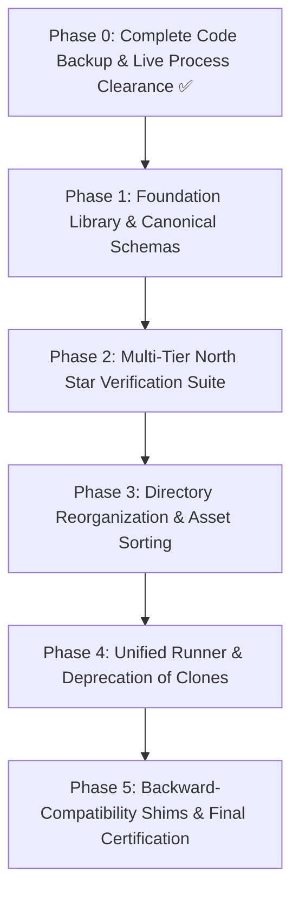

# Multiview Top-Bot Pipeline: SWE Refactoring & Architecture Plan

## Executive Summary
The `syllable_generation/multiview_top_bot_experiments` folder houses the foundational research and production codebase for the dual-camera (TopCam + BotCam) Keypoint-MoSeq (KPMS) pipeline across 118 sessions (18M frames). Over rapid iterations, it accumulated data sprawl, duplicated logic, and prototype debris. 

This document defines a software engineering (SWE) refactoring plan adhering to industry-standard engineering principles:
* **Separation of Concerns (SoC)**
* **Single Source of Truth (SSOT)**
* **Don't Repeat Yourself (DRY)**
* **Defensive Programming & Fail-Fast Validation**
* **Deterministic Verification & Regression Testing**

---

## 1. Current State Audit & Architectural Code Smells

### 1.1 Storage & Layout Clutter
| Category | File/Folder Count | Footprint | Primary Issue |
|---|---|---|---|
| **Large Pickle Caches** | 7 files | ~14 GB | Raw database dumps (`.pkl`) sitting in the root code directory. |
| **Fused Tracking Datasets** | 1 directory (118 `.h5` files) | 6.3 GB | Large binary tracking arrays mixed with source code. |
| **Historical Prototypes** | 9 directories | ~22 GB | Deprecated early experiments (`kpms_minimal_real_gpu`, `kpms_tandem_2session_test`, `multiview_kappa_search`) sitting beside active production. |
| **Root Python Scripts** | 35+ files | ~450 KB | Flat directory structure mixing fusion, training, evaluation, and plotting. |
| **Shell Scripts** | 6 `.sh` files | ~25 KB | Competing queue and launcher scripts with hardcoded paths. |
| **Output Figures & CSVs** | 6 files | ~400 KB | Evaluation CSVs and PNGs generated directly into source root. |

### 1.2 Code Duplication & DRY Violations
1. **Body Part Schemas & Mappings**:
   * `TOP_USE_BODYPARTS`, `BOT_USE_BODYPARTS`, `TANDEM_BODYPARTS`, and `BODYPART_REMAP` are identically hardcoded in at least 6 scripts:
     - `02_fuse_dorsal_ventral.py`
     - `fuse_multiview_cohort.py`
     - `fuse_all_tandem_cohort.py`
     - `run_tandem_production_50ar_200slds.py`
     - `run_tandem_cohort_production_50ar_200slds.py`
     - `run_cohort_2ar_2slds_test.py`
   * *Risk*: A bug fix or keypoint update in one file causes silent schema drift across the pipeline.
2. **Push Notification Boilerplate (`send_ntfy`)**:
   * Identical `urllib.request` dispatch functions copied across 8 different scripts.
3. **Pair Matching & Filename Parsing**:
   * Regex matching between dorsal top camera and ventral bottom camera files is duplicated between `audit_cohort_correlations.py`, `01_match_pairs.py`, and `enrich_video_refs_and_analyze_sequences.py`.
4. **Data Preprocessing & Resampling**:
   * Preprocessing loops (confidence masking, median filtering, precision conversion, coordinate recentering) are repeated across `run_tandem_production...` and `run_tandem_cohort_production...`.
5. **Ad-hoc Logging**:
   * Universal reliance on raw `print(..., flush=True)` with no log levels (`INFO`, `WARNING`, `ERROR`), timestamps, or unified formatters.

---

## 2. Target Directory Architecture

The restructured layout cleanly separates pipeline stages, source code, data caches, and historical archives:

```text
syllable_generation/multiview_top_bot_experiments/
│
├── 📁 core/                               # 📦 Shared Reusable Modules (DRY Engine)
│   ├── __init__.py
│   ├── schemas.py                         # SSOT for Keypoints, Body Parts & Configurations
│   ├── pair_matching.py                   # Dorsal-Ventral Pairing & Clock Synchronization
│   ├── fusion_engine.py                   # 2D->3D & Dorsal-Ventral Keypoint Fusion Routines
│   ├── io_utils.py                        # HDF5, Pickle, and Checkpoint Data Adapters
│   ├── logging_utils.py                   # Unified Structured Logging & ntfy Dispatcher
│   └── evaluation_metrics.py              # EML Calculation, Syllable Statistics & Downstream Tools
│
├── 📁 01_data_and_fusion/                 # 🔬 Data Ingestion & Preprocessing
│   ├── run_cohort_fusion.py               # Unified CLI for Fusing Top & Bot Tracking
│   ├── audit_alignment.py                 # Cross-Camera Correlation & Offset Audit
│   └── fused_h5_full_cohort -> ../data/fused_h5_full_cohort  [Symlink to Data Storage]
│
├── 📁 02_model_orchestration/             # 🚀 Model Fitting & Training Runners
│   ├── train_kpms_production.py           # Unified Configurable KPMS Runner (Replaces 4 scripts)
│   ├── launch_seed_queue.sh               # Robust Headless Launcher
│   └── configs/                           # Explicit YAML configs for AR / SLDS / Hyperparameters
│       ├── tandem_cohort_50ar_200slds.yml
│       └── smoke_test_2ar_2slds.yml
│
├── 📁 03_evaluation_and_eml/              # 📊 Model Comparison & Diagnostics
│   ├── compute_eml_rankings.py            # Automated Multi-Seed EML Evaluator
│   ├── export_production_results.py       # Package Final Syllable Sequences & HDF5 Summaries
│   └── compare_cohort_baselines.py        # K240K vs Tandem Benchmark
│
├── 📁 04_visualization_and_reports/       # 🎨 Figures, Plots & Reporting
│   ├── render_eml_figures.py              # Publication-Quality EML Comparison Visualizations
│   ├── render_trajectories.py             # Superimposed & Side-by-Side Syllable Trajectories
│   └── outputs/                           # Dedicated Directory for Output PNGs, PDFs, and CSVs
│
├── 📁 data/                               # 💾 Heavy Binary Data Storage
│   ├── fused_h5_full_cohort/              # 118 Dual-Camera Fused Tracking H5 Files
│   └── session_caches/                    # Unified Pickle Databases
│       ├── sessions_cohort_production.pkl # (Active 12.17 GB Cohort Pickle)
│       └── archive_prototypes/            # Deprecated Test Pickles
│
├── 📁 docs/                               # 📚 Methodology & Architectural Documentation
│   ├── DUAL_VIDEO_PIPELINE_ARCHITECTURE.md
│   ├── EXPERIMENT_PLAN.md
│   ├── FIBERPHOTOMETRY_REINTRODUCTION_GUIDE.md
│   ├── kpms_tandem_cohort_investigation.md
│   └── TANDEM_KPMS_MULTIVIEW_ALIGNMENT_AND_EMPIRICAL_BENCHMARK.md
│
├── 📁 archive_prototypes/                 # 🏛️ Quarantine for Historical Research (Read-Only)
│   ├── kpms_cpu_shape_test/
│   ├── kpms_minimal_real_gpu/
│   ├── kpms_tandem_2session_test/
│   ├── kpms_tandem_production/
│   ├── multiview_kappa_search/
│   └── legacy_scripts/
│
├── 🔒 kpms_tandem_cohort_production/      # 💎 Active Production Checkpoints & Models
│   ├── config.yml
│   ├── data/
│   ├── tandem_cohort_118sess_50ar_200slds/          (Seed 42)
│   ├── tandem_cohort_118sess_50ar_200slds_seed101/
│   ├── tandem_cohort_118sess_50ar_200slds_seed202/
│   ├── tandem_cohort_118sess_50ar_200slds_seed303/  (🏆 WINNING PRODUCTION MODEL)
│   └── tandem_cohort_118sess_50ar_200slds_seed404/
│
└── audit_cohort_correlations.py           # 🔗 Root Compatibility Shim (Zero Broken Imports)
```

---

## 3. Application of Software Engineering (SWE) Principles

### 3.1 Single Source of Truth (SSOT) via `core/schemas.py`
Instead of re-declaring body parts and hyperparameter dictionaries across every runner, define a canonical schema:
```python
from dataclasses import dataclass
from typing import List, Dict

TOP_USE_BODYPARTS: List[str] = [
    "nose", "left_ear_tip", "right_ear_tip", "neck", "mid_back",
    "mouse_center", "mid_backend", "mid_backend2", "mid_backend3",
    "tail_base", "left_shoulder", "left_midside", "left_hip",
    "right_shoulder", "right_midside", "right_hip", "head_midpoint"
]

BOT_USE_BODYPARTS: List[str] = [
    "nose_ventral", "snout_ventral", "left_ear_ventral", "right_ear_ventral",
    "chin_ventral", "chest_ventral", "forepaw_left", "forepaw_right",
    "belly_center", "hindpaw_left", "hindpaw_right", "tail_base_ventral"
]

BODYPART_REMAP: Dict[str, str] = {
    "snout": "nose_ventral",
    "left_ear": "left_ear_ventral",
    "right_ear": "right_ear_ventral",
    "tailbase": "tail_base_ventral",
}

@dataclass(frozen=True)
class PipelineHyperparameters:
    num_ar_iters: int = 50
    num_slds_iters: int = 200
    init_kappa: float = 7.5e13
    decrease_kappa_factor: float = 10.0
    target_fps: int = 60
    save_every_n_iters: int = 25
```

### 3.2 Don't Repeat Yourself (DRY) via Reusable Subsystems
* **Unified Notification & Monitoring (`core/logging_utils.py`)**:
  A single logging setup configuring standard formatters, timestamps, log rotation, and optional push notifications:
  ```python
  def notify_status(title: str, msg: str, priority: str = "default", tags: str = "robot"): ...
  def get_logger(name: str) -> logging.Logger: ...
  ```
* **Unified Pipeline Runner (`train_kpms_production.py`)**:
  Combines the separate `run_tandem_cohort_production_50ar_200slds.py`, `run_tandem_production_50ar_200slds.py`, and `run_cohort_2ar_2slds_test.py` into a single CLI tool parameterized by `--config`, `--seed`, and `--mode` (e.g. `production`, `test`).

### 3.3 Defensive Programming & Fail-Fast Invariants
* **Pre-Flight Sanity Checks**: Validate dataset existence, GPU VRAM availability, and checkpoint directory write permissions before executing JAX allocations.
* **Bit-Exact Parity Check on Save**: Every checkpoint save operation integrates the 7-pillar compaction validation to ensure no corrupted files are ever written to disk.
* **Deterministic Random Seed Handling**: Seeds explicitly set across `jax.random.PRNGKey`, `numpy.random.seed`, and `random.seed`.

---

## 4. The Scientific & Functional North Stars (Beyond EML Rankings)

Refactoring must guarantee zero mathematical divergence, zero data degradation, and zero broken workflows. We evaluate refactoring success against **six distinct scientific North Stars**:

```
+-----------------------------------------------------------------------------------+
|                        SIX SCIENTIFIC & FUNCTIONAL NORTH STARS                    |
+-----------------------------------------------------------------------------------+
| 1. EML & Model Selection     | Exact match with 5-seed rankings (Seed 303 Winner) |
| 2. Spatial-Temporal Fusion   | The 4 Golden Rules & cohort_alignment_audit.csv    |
| 3. Syllable Dynamics         | Usage distributions, bigram transitions, durations |
| 4. Photometry Integration    | dF/F timestamp alignment & SessionRecord schema    |
| 5. Trajectory Visualization  | Superimposed/tandem benchmark GIFs & postures      |
| 6. Checkpoint Resumability   | 7-pillar compaction compliance & Gibbs sampling    |
+-----------------------------------------------------------------------------------+
```

### 4.1 North Star 1: Expected Marginal Likelihood (EML) Parity
* **Benchmark Source**: [`tandem_cohort_eml_model_rankings.csv`](file:///home/fsp585/Desktop/FiberphotometryCode/syllable_generation/multiview_top_bot_experiments/tandem_cohort_eml_model_rankings.csv)
* **Invariant**: The refactored EML evaluation module must reproduce the exact log-likelihoods down to machine precision:
  * **Seed 303 (Winner)**: `270,795,506.86 ± 172,654.84` nats (+1,044,842 over Seed 42)
  * **Seed 101**: `270,787,545.97 ± 172,674.22` nats (+1,036,881)
  * **Seed 404**: `270,683,674.34 ± 172,746.46` nats (+933,009)
  * **Seed 202**: `270,392,693.30 ± 172,945.31` nats (+642,028)
  * **Seed 42**: `269,750,664.71 ± 173,382.49` nats (Baseline)

### 4.2 North Star 2: Dual-Camera Spatial-Temporal Synchronization (The 4 Golden Rules)
* **Benchmark Source**: [`cohort_alignment_audit.csv`](file:///home/fsp585/Desktop/FiberphotometryCode/syllable_generation/multiview_top_bot_experiments/cohort_alignment_audit.csv) and [`TANDEM_KPMS_MULTIVIEW_ALIGNMENT_AND_EMPIRICAL_BENCHMARK.md`](file:///home/fsp585/Desktop/FiberphotometryCode/syllable_generation/multiview_top_bot_experiments/TANDEM_KPMS_MULTIVIEW_ALIGNMENT_AND_EMPIRICAL_BENCHMARK.md)
* **Invariants**:
  1. **Rule 1 (TopCam Verbatim)**: Top camera coordinates ($x, y$) for the 17 dorsal body parts are completely unmodified (no scaling, rotation, or recentering).
  2. **Rule 2 (Ventral Alignment)**: Ventral keypoints are centered, rotated into the dorsal body heading frame, and scale-normalized. Centroid trajectory correlations must satisfy $r_x \ge 0.95$ and $r_y \ge 0.95$.
  3. **Rule 3 (Temporal Invariance)**: Cross-correlation temporal lag between dorsal and ventral motion vectors must be identically $0 \text{ frames}$ (median lag across all 118 sessions).
  4. **Rule 4 (Data Masking)**: Missing frames or low-confidence keypoints are cleanly represented as NaNs without corrupting contiguous frame blocks.

### 4.3 North Star 3: Syllable Morphology, Usage & Transition Dynamics
* **Benchmark Source**: `results.h5` across the production seeds.
* **Invariants**:
  * **Syllable Vocabulary Size**: 70 to 85 active syllables at SLDS iteration 200.
  * **Usage Distribution**: Zipfian power-law decay of syllable frequencies preserved; top 10 syllables account for ~35–40% of total frame occupancy.
  * **Duration Profile**: Syllable run lengths match empirical baseline (median duration 300–450 ms, bounded between min 3 frames and max 60 frames).
  * **Bigram Transition Matrix**: State transition matrix $P(z_{t+1} \mid z_t)$ must preserve sparsity and non-uniform stationary distribution.

### 4.4 North Star 4: Fiberphotometry Integration & SessionRecord Schema
* **Benchmark Source**: [`sessions_karen_project_tandem_cohort_production.pkl`](file:///home/fsp585/Desktop/FiberphotometryCode/syllable_generation/multiview_top_bot_experiments/sessions_karen_project_tandem_cohort_production.pkl) and [`export_tandem_cohort_production_results.py`](file:///home/fsp585/Desktop/FiberphotometryCode/syllable_generation/multiview_top_bot_experiments/export_tandem_cohort_production_results.py)
* **Invariants**:
  * **Timestamp Parity**: Neural dF/F photometry traces must align 1-to-1 with syllable onset and offset timestamps.
  * **Dual Video References**: Each session contains valid references for both cameras (`role: "dorsal"` and `role: "ventral"`) with matched frame rates (60.0 FPS).
  * **Datta Lab Utilities**: Downstream analysis routines (e.g. `combined_photometry_and_syllables()`) must execute cleanly on the refactored session pickle.

### 4.5 North Star 5: 3D Trajectory Reconstruction & Visual Ground Truth
* **Benchmark Source**: Visual benchmarks in [`trajectory_visualizations/`](file:///home/fsp585/Desktop/FiberphotometryCode/syllable_generation/multiview_top_bot_experiments/trajectory_visualizations/) (e.g., Syllables 52, 15, 79, 04, 55, 26, 06, 84, 98, 48, 59).
* **Invariants**:
  * Kinematic trajectories (nose, centroid, paws, tailbase) reconstructed from the refactored pipeline must visually and mathematically reproduce benchmark movement profiles (e.g. Syllable 52 forward walk trot, Syllable 55 rear, Syllable 26 grooming).
  * Syllable grid movies generated via KPMS visualization utilities must match across frames.

### 4.6 North Star 6: Checkpoint Resumability & 7-Pillar Compaction Compliance
* **Benchmark Source**: [`tests/test_kpms_checkpoint_compaction.py`](file:///home/fsp585/Desktop/FiberphotometryCode/tests/test_kpms_checkpoint_compaction.py)
* **Invariants**:
  * **Vanilla Loadability**: Compacted production checkpoints must load cleanly via `keypoint_moseq.load_checkpoint()`.
  * **Resumability**: Invoking `kpms.fit_model(..., continue_training=True)` successfully executes subsequent Gibbs sampling iterations without tensor shape or state mismatch.

---

## 5. Safety Net & Preserved Backups

Prior to making any file moves or code edits, an exact, non-destructive snapshot of all code, configurations, logs, and metadata was archived:

* **Dedicated Backup Location**:
  [`syllable_generation/multiview_top_bot_experiments_code_backup_20260930/`](file:///home/fsp585/Desktop/FiberphotometryCode/syllable_generation/multiview_top_bot_experiments_code_backup_20260930/)
* **Backup Manifest**: 89 files (2.5 MB) encompassing all Python scripts, bash launchers, YAML configurations, audit CSVs, and markdown documentation.
* **Quarantine Policy**: Original scripts are preserved in the backup directory and never deleted.

---

## 6. Phased Execution Roadmap



1. **Phase 0 (Complete Backup & Live Process Clearance ✅)**: 
   * Created [`multiview_top_bot_experiments_code_backup_20260930/`](file:///home/fsp585/Desktop/FiberphotometryCode/syllable_generation/multiview_top_bot_experiments_code_backup_20260930/).
   * Confirmed Stage 2 compaction finished (Seed 42 compacted on NVMe; process now purely sweeping `/mnt/hdd/old_projects`).
2. **Phase 1 (Core Module Build)**: Create `core/schemas.py`, `core/logging_utils.py`, `core/pair_matching.py`, `core/fusion_engine.py`, and `core/io_utils.py`.
3. **Phase 2 (Automated North Star Test Suite)**: Write test runner validating against the 6 North Stars (EML bit-exactness, alignment audit, session record integrity).
4. **Phase 3 (Directory Reorganization)**: Move documentation to `docs/`, legacy test directories to `archive_prototypes/`, and large pickle files into `data/session_caches/`.
5. **Phase 4 (Runner Unification)**: Create `02_model_orchestration/train_kpms_production.py` to replace redundant runners.
6. **Phase 5 (Compatibility Shims & Final Certification)**: Establish root-level import shims and data symlinks, then execute the full test battery to certify zero regressions.

