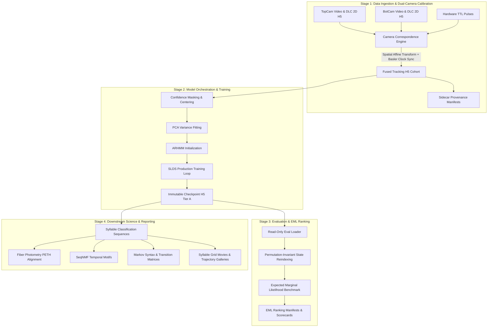

# System Architecture & Stage Data Flow

## 1. Architectural Principles

This platform adheres to five foundational engineering standards:
1. **Separation of Concerns (SoC)**: Pipeline orchestration, mathematical modeling, file input/output, and visualization rendering operate across distinct, modular boundaries.
2. **Single Source of Truth (SSOT)**: Body part indices, coordinate schema mappings, and hyperparameter structures are defined once in [`core/schemas.py`](file:///home/fsp585/Desktop/FiberphotometryCode/core/schemas.py) and inherited pipeline-wide.
3. **Defensive Immutability**: Production checkpoints (`checkpoint.h5`), model states, and empirical manifests are treated as write-once artifacts. Checkpoint modifications are strictly prohibited in-place; all updates write to new paths atomically (`temp + fsync + rename`).
4. **Hardware-Aware Memory Compaction**: Large multi-gigabyte training runs isolate subprocesses, enforce Linux page-cache compaction, and invoke CUDA memory evictions to prevent out-of-memory (OOM) failures.
5. **Deterministic Verification**: Every stage emits sidecar metadata manifests (`.manifest.json`) verifying upstream inputs, parameter hashes, software versions, and git state.

---

## 2. End-to-End Pipeline Data Flow

The canonical active analysis pipeline ([`syllable_generation/multiview_top_bot_experiments/`](file:///home/fsp585/Desktop/FiberphotometryCode/syllable_generation/multiview_top_bot_experiments/)) processes 118 dual-camera sessions (~18M frames) across four staged phases:

---

## 3. Detailed Stage Breakdown

### Stage 1: Data Ingestion & Dual-Camera Calibration (`01_data_and_fusion/`)
- **Spatial Registration**: Computes affine calibration matrices aligning ventral (bottom) coordinates with dorsal (top) arena space. Handles reflection inversion and arena boundary offsets.
- **Temporal Alignment**: High-frequency hardware TTL pulse matching and Basler camera crystal oscillator drift compensation. Validates sub-millisecond sync across recordings.
- **Fusion Engine**: Combines dorsal (21-keypoint) and ventral tracking arrays into canonical 23-keypoint or 21-keypoint synchronized representations. Writes fused `.h5` files atomically accompanied by `.manifest.json`.

### Stage 2: Model Orchestration & Training (`02_training_runners/`)
- **Data Preparation**: Confidence thresholding, median smoothing, and spatial coordinate centering.
- **PCA Decomposition**: Projects high-dimensional keypoints into principal posture components ($D=10$ or $12$ latent dimensions), capturing $>90\%$ postural variance.
- **Model Fitting**:
  - Autoregressive HMM (ARHMM) initialization ($25$ to $50$ iterations) establishing initial state boundaries.
  - Switching Linear Dynamical Systems (SLDS) inference ($200$ to $400$ iterations) fitting continuous latent dynamics and discrete transition stickiness priors ($\kappa$).
- **Compaction & Immutability**: Model checkpoints are written with atomic temp-files and verified before promotion.

### Stage 3: Evaluation & EML Ranking (`03_evaluation_and_eml/`)
- **Read-Only Model Loading**: Guarantees zero in-place mutations on source checkpoints (`r` mode only).
- **Stable State Permutation**: Resolves tied state frequencies via deterministic sort algorithms, mapping raw hidden states to standardized frequency-ranked syllable indices ($0 \dots K-1$).
- **Expected Marginal Likelihood (EML)**: Computes held-out predictive log-likelihood across multiple random initialization seeds (Seeds 101, 202, 303, 404, 505) to benchmark posture separation without model bias.

### Stage 4: Downstream Analytics & Visualization (`04_reports_and_figures/`)
- **Trajectory Renderings**: Superimposed 3D/2D posture traces colored by temporal phase.
- **Grid Movies**: Synchronized multi-tile video mosaics sampling discrete syllable instances via uniform density sampling.
- **Fiber Photometry Correlation**: Aligns discrete syllable onset/offset timestamps with continuous multi-channel fluorescence signals ($\Delta F/F$, dopamine, serotonin, noradrenaline transients).
- **Higher-Order Syntax**: Computes empirical transition probability matrices, Markov order entropy tests, and SeqNMF factorizations of behavioral chains.

---

## 4. Module Boundaries & Dependencies

| Module | Core Responsibility | External Dependencies |
|---|---|---|
| [`core.schemas`](file:///home/fsp585/Desktop/FiberphotometryCode/core/schemas.py) | Definitions of body parts, keypoint indices, naming conventions | None (Standard Library) |
| [`core.paths`](file:///home/fsp585/Desktop/FiberphotometryCode/core/paths.py) | Workspace-relative path resolution and environment hooks | `pathlib`, `os` |
| [`core.camera_correspondence`](file:///home/fsp585/Desktop/FiberphotometryCode/core/camera_correspondence.py) | Affine registration, timestamp drift estimation | `numpy`, `scipy` |
| [`core.fusion_engine`](file:///home/fsp585/Desktop/FiberphotometryCode/core/fusion_engine.py) | Keypoint array fusion and coordinate normalization | `numpy`, `h5py` |
| [`core.io_utils`](file:///home/fsp585/Desktop/FiberphotometryCode/core/io_utils.py) | Defensive serialization and safe file adapters | `h5py`, `pickle` |
| [`core.h5_guard`](file:///home/fsp585/Desktop/FiberphotometryCode/core/h5_guard.py) | Immutability check and write mode rejection | `os`, `stat` |
| [`core.cache_manifest`](file:///home/fsp585/Desktop/FiberphotometryCode/core/cache_manifest.py) | Input/output hashing and sidecar verification | `hashlib`, `json` |
| [`core.eval_artifacts`](file:///home/fsp585/Desktop/FiberphotometryCode/core/eval_artifacts.py) | Checkpoint verification and permutation sorting | `numpy`, `h5py` |
| [`core.logging_utils`](file:///home/fsp585/Desktop/FiberphotometryCode/core/logging_utils.py) | Structured logging and webhook dispatch | `logging`, `urllib` |
