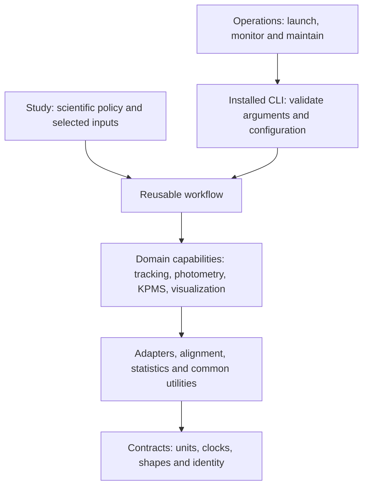

# Refactor presentation and agent-workflow assessment

2026-10-11. Based on committed checkout `3ec30fb`, the current uncommitted navigation work, the `pre-scaffolding-20261009` tag, the `codex/legacy-consolidation` branch, preserved reports and read-only verification. This document explains the changes and recommends the next agent-workflow improvements; it does not implement those recommendations.

## 1. The main change

The repository has moved from a collection of research scripts with shared infrastructure scattered through project trees toward an installable scientific library surrounded by project-owned research, operational tooling and compatibility adapters.

The scientific pipeline is still recognizable:

```text
recordings and tracking → camera/time alignment → posture models
                      → state sequences and photometry alignment
                      → quantitative analyses, figures and movies
```

The refactor changes where these capabilities live, how callers supply policy and how behavior is checked. It does not establish that every historical study was reproduced or that all possible datasets yield identical results.

## 2. What we compared

`main` currently points at `67468c1`, dated 2025-10-08. Its tracked root mostly contains `fiberphotometry` and tests. It is too old to represent the complete research workspace immediately before this refactor.

The better baseline is `pre-scaffolding-20261009`: 1,609 tracked Python files, no `src/fpcode` package, multiple research/export bundles, `syllable_generation`, `fiberphotometry`, monoamine analyses, backups, scripts and many engineering reports at the root.

`codex/legacy-consolidation` at `b83298f` is an intermediate refactor, not the original baseline. It already contains 121 canonical library modules, but still retains old root source/data locations and modality-grouped studies. The current committed library has 140 Python modules. Whole-repository file counts include adapters, archives and examples, so they are not a useful standalone quality score.

Useful historical references are `docs/reports/REFACTORING_CHANGE_REPORT.md` and `docs/ARCHITECTURE.md`. Their old paths and stronger claims belong to their recorded checkpoint. Current ownership is defined by `docs/architecture/UNIT_CONTRACT.md` and checked by `ops/repo/dependencies.py`.

## 3. Before and after

| Responsibility | Earlier arrangement | Current arrangement | Practical benefit |
| --- | --- | --- | --- |
| Shared algorithms | Repeated utilities and mechanisms inside large runners/project trees | `src/fpcode/<capability>` | Reusable APIs can be imported and tested independently |
| Scientific settings | Module globals, workstation paths and cohort defaults mixed into mechanisms | Explicit configuration/contracts, project policy and named historical profiles | Reusing an algorithm need not silently select a cohort |
| Study ownership | `syllable_generation`, `fiberphotometry`, then `studies/behavior` and `studies/photometry` | `studies/<project>` | One home for a project's analyses, notebooks and policies |
| Operational tools | Root scripts and real implementations behind organized-directory forwarders | Implementations in purpose-specific `ops` directories | Agents and humans can find the owner directly |
| Historical callers | Old imports and file paths were part of the effective API | Root `compat`, library `fpcode.compat`, retained physical adapters | Existing notebooks/imports can survive while canonical callers migrate |
| Empirical storage | Data, models, videos and logs mixed with source | `data/{raw,sessions,models,fused,analysis_cache}` and `outputs` | Source operations can avoid huge empirical payloads |
| Testing | Loose files, research notebooks and selected test-path lists | Full synthetic discovery by category; empirical opt-in | More predictable validation with fewer accidental data jobs |
| Distribution | Environment-specific execution and import-path manipulation | Installable package, five CLI entry points and wheel/resource checks | Users can call supported interfaces outside this checkout |
| Navigation | Familiarity with project history was often necessary | Maintained docs, ownership contract and proposed generated folder maps | New contributors have a route into the code |

Several of these boundaries are still being completed. In particular, moving a file does not repair its constructed filesystem paths or make its numerical policy generic.

## 4. The new tree, by responsibility

```text
FiberphotometryCode/
├── src/fpcode/             shared implementation
│   ├── contracts/          shapes, units, clocks, identity and artifact records
│   ├── common/             paths, logging, I/O, manifests and run records
│   ├── adapters/           external-format decoding
│   ├── alignment/          explicit temporal/frame mappings
│   ├── statistics/         generic numerical/statistical primitives
│   ├── behavior/           kinematics, bouts and sequence methods
│   ├── tracking/           camera correspondence and fusion
│   ├── photometry/         signal and event analysis
│   ├── kpms/               modeling, preprocessing and optimization backend
│   ├── viz/                reusable geometry, selection and rendering
│   ├── workflows/          composition of reusable capabilities
│   ├── cli/                installed command-line interfaces
│   └── compat/             historical library implementations/profiles
├── studies/<project>/      research policy, analyses, notebooks and launchers
├── ops/<purpose>/          monitoring, DLC, compaction, repository and backup tools
├── configs/                explicit profiles and environment definitions
├── tests/                  unit, integration, regression, architecture, empirical
├── compat/                 historical top-level import/file namespaces
├── data/                   ignored empirical inputs and model artifacts
├── outputs/                generated run products and validation evidence
├── docs/                   current guides and dated reports
├── registry/               moves, shims, diagnostics and artifact inventories
├── vendor/                 retained dependency/custom fork material
└── archive/                preserved inactive material
```

This is the ownership model, not a literal claim about the exact number of root entries. `core` and `pipelines` still provide physical historical adapters. Old study/data directory aliases also remain during migration. The committed root does not list ignored local data/output directories in `git ls-tree`, even though those directories exist in the workspace.

Two compatibility locations serve different purposes: root `compat/` preserves old namespaces such as `syllable_generation`; `src/fpcode/compat/` owns historical implementations and defaults behind old library APIs. An agent must distinguish them when repairing imports or pickles.

## 5. How a new feature should flow



This is a simplified responsibility diagram, not the exact dependency matrix. The matrix permits deliberate cross-capability edges and narrowly documented compatibility facades. Its precise rules live in the audit.

For example, a project selects fluorescence channels, exclusions, event definitions and alignment policy. A reusable photometry workflow receives that policy and explicit signal/event contracts. It does not import the project module to discover a global setting.

For a KPMS experiment, the project selects inputs, model settings, seed and output location. The library supplies initialization, training and backend optimizations. The installed training CLI expects already-preprocessed data; it is not a universal raw-video-to-model pipeline.

## 6. KPMS optimizations are part of the reusable product

Most major mechanisms already live in `src/fpcode/kpms/backend`: batch configuration/sizing, state caching, memory residency, patch management and kernels for discrete states, autoregression, continuous trajectories, scales/heading and location.

`fpcode.kpms.runtime` exposes the established interface, including `apply_optimizations`, `restore_original_kernels` and the scoped `kpms_optimizations` context manager. Patch restoration is part of the contract; changes must preserve the entry value in each patched namespace.

Several files under `vendor/keypoint_moseq_syll/utils` now forward to the library. The vendor tree still mixes retained custom mechanisms, old experiments, project scripts and historical fork material. Its older `custom_kernels.py` and flipping utilities require deliberate ownership review rather than wholesale copying.

What is missing is a clear user-facing optimization guide: public entry points, compatible dependency versions, activation examples, resource tradeoffs and benchmark evidence. Package presence alone does not make a useful extension discoverable. Claims about speed or sampler equivalence should refer to measured settings and tests.

## 7. What verification currently establishes

Read-only checks performed while preparing this presentation:

| Check | Observed result | Limit |
| --- | --- | --- |
| Full default local suite | 440 passed, 7 warnings, 9.75 seconds | Uses the existing complete lab environment and selected synthetic assertions |
| Architecture audit | 140 modules, zero violations and cycles | Static graph under configured rules; computed imports/path semantics need review |
| Maintained-source lint | Strict paths pass; 3,079 current diagnostics accepted by the debt guard | Passing does not mean zero lint debt or establish its historical provenance |
| Proposed folder-map check | Passes | Synchronization with a generator does not establish semantic accuracy |

Earlier installed-wheel verification exercised package origin, five CLI help commands, `py.typed` and three JSON resources outside the checkout. It reused existing dependencies and is not a minimal clean-environment installation proof. This presentation did not rerun that check or remotely inspect GitHub CI.

The four failures at the earlier handoff are now repaired: three historical/canonical identity/import-order checks and a golden-source relocation lookup. The saved numerical golden fixture remains unchanged, and the test still checks 73 non-excluded AST bodies.

The small earlier GPU diagnostic performed two AR and two SLDS updates on two 256-frame excerpts. It establishes that bounded execution path, not full-cohort convergence or universal scientific invariance. The earlier 96.37 GB snapshot excludes substantial empirical data and predates later edits; it is not a complete current data backup.

## 8. The refactor is usable, but not finished

The largest remaining mechanisms have not been extracted: `adapters/session_sources`, `workflows/session_building.py` and `viz/composite_movies` are still absent. Session builders and movie composers retain project/global-configuration responsibilities that need separating with explicit policy and independent expectations.

Other outstanding work includes remaining literal/constructed study paths, compatibility retirement obligations, KPMS parsing/counting ownership, vendor extension ownership and several locally maintained diagnostic files ignored by Git.

The synthetic checkpoint regression still imports `fpcode.kpms.checkpoints`, which eagerly imports Keypoint-MoSeq/JAX. The proposed CPU workflow excludes that backend. A pass in the lab environment therefore does not establish clean CPU CI. Preserve historical compaction signatures and `full`/`slim` behavior when repairing this boundary; the newer backend-free checkpoint API is not an interchangeable replacement.

These are practical implementation gaps. Adding more instructions will not fix them by itself.

## 9. What is already helpful for agents

The repo has a good foundation: explicit ownership, dependency enforcement, small tests, CLI help/dry-run support, configuration profiles, source/data separation, migration ledgers and atomic run records.

`RunRecord` already stores command/argv, Git SHA and dirty state, effective configuration and hashes, seed, environment/executable, and input/output size/mtime fingerprints. Extend this mechanism rather than creating a second competing run-manifest system. Backend versions and JAX device information are useful additions; current GPU inspection is limited to an already-initialized Torch backend.

One repository skill exists: `.agents/skills/kpms-visualizations/SKILL.md`. A nomenclature rule exists under `.agents/rules`. No repository `AGENTS.md`, `AGENTS.override.md`, `CLAUDE.md` or `GEMINI.md` was found in the relevant source scan.

The current checkout also contains uncommitted `ARCHITECTURE_INDEX.md`, 141 `.folder-map.md` files totaling approximately 187 KB, their generator, and Makefile/pre-commit integration. These changes were already present when this request began and were not modified for this presentation.

## 10. Recursive Markdown: useful navigation, with limits

Generated folder maps are a reasonable way to look up modules without importing GPU/scientific backends. Read one subsystem and relevant leaf, or use direct `rg` lookup when the symbol is known. Never require an agent to consume all 141 maps before a task.

The current maps need correction before serving as authoritative guidance:

- The root index hardcodes 121 modules and roughly six-second tests; the current observations are 140 modules and 440 tests in 9.75 seconds.
- It describes `pipelines` as substantive workflow runners; current canonical CLI lives in `fpcode.cli` and `pipelines` provides adapters.
- It conflates historical top-level namespaces with `src/fpcode/compat`; root `compat` has a separate purpose.
- Some descriptions repeat old module docstrings such as `core.evaluation_metrics`, so an AST-derived map can faithfully reproduce stale information.
- It calls the map check a CI gate, but the inspected GitHub workflow does not invoke it.
- Subsystem dependency summaries are truncated and relative imports are not fully qualified. Treat them as navigation hints; use the real audit for dependency claims.
- The generator uses recursive enumeration before filtering excluded paths. Prune excluded directories before traversal to avoid unnecessary scans of retained artifacts, and preserve symlink boundaries.

Keep derived symbol/file facts generated and human scientific/operational guidance curated. Give each generated symbol its owning file link and distinguish public APIs from helpers, facades and old runners. Avoid a fresh instruction file in every directory; most leaves need no special behavioral rules.

## 11. Recommended agent layer

This is a proposed layout, not a set of files created by this presentation:

```text
AGENTS.md                        concise repository-wide operating guidance
src/fpcode/AGENTS.md              library dependency, import and API invariants
studies/AGENTS.md                 scientific policy and empirical-input rules
compat/AGENTS.md                  identity, pickle and physical-entry obligations
ops/AGENTS.md                     operation-specific effects and validation
docs/agent-workflows/             reusable task recipes, linked when relevant
docs/tasks/                      dated task state and handoffs for long work
.agents/skills/
    kpms-visualizations/          repair the existing skill first
    repo-validation/             select and report the right checks
    kpms-run/                    configure, inspect and validate a scoped run
```

`AGENTS.md` should answer: where to start, where code belongs, how to select an interpreter, what checks apply, what scientific invariants matter and where longer references live. Keep workstation-specific settings as examples or explicit environment inputs rather than requirements for every contributor.

For Codex, project instruction discovery is rooted at the repository and proceeds toward the current working directory, with more local guidance taking precedence. A root instruction should route an agent to relevant specialized guidance when work starts at the root; do not assume every nested file is injected. Verify discovery in the actual client. Other clients may have different entry-file conventions, so use small adapters linking shared guidance instead of maintaining contradictory copies. [Official AGENTS.md guidance](https://learn.chatgpt.com/docs/agent-configuration/agents-md).

Use skills for repeatable jobs with meaningful inputs, outputs and verification. Codex discovers skill metadata first and loads the full instructions when it selects the skill; this supports focused recipes instead of loading every workflow into the root instructions. [Official skills guidance](https://learn.chatgpt.com/docs/build-skills).

The existing visualization skill is the first repair candidate. It contains retired absolute paths, environment-specific fixes and cohort-specific 40/80 Hz assumptions. A video's length or maximum frame index is insufficient to establish its clock convention. Use explicit metadata, unit contracts and known frame mappings; preserve study-owned rate policy rather than silently applying a universal 2× rule.

Candidate repeatable workflows:

| Workflow | Explicit inputs | Expected outcome |
| --- | --- | --- |
| Validate a code change | Changed capability, interpreter, intended behavior | Relevant regression checks plus library architecture/lint where applicable; exact evidence |
| Configure a KPMS run | Preprocessed input, profile, seed, device, model output and resource limits | Validated dry-run, scoped execution when requested, recorded configuration/artifacts |
| Generate scientific media | Results, VFI clock convention, videos, selection/FPS/output policy | Small preview and validated mappings before the requested render |
| Compare model artifacts | Named runs, metric definition, input provenance and permutation policy | Reproducible comparison without silently retraining or altering source checkpoints |

Some workflows are not ready for a reliable skill until their canonical mechanism exists. Do not wrap a broken global-config builder in an elaborate prompt and call it solved.

## 12. Make workflows executable and verifiable

An agent benefits from a short, deterministic path: identify the owner → inspect inputs and policy → choose the supported command/API → validate configuration → run the requested scope → check outputs → record evidence.

Practical next additions, in priority order:

1. **Ground navigation and instructions.** Correct the existing maps, add a short root `AGENTS.md` and only the necessary scoped invariants. Link the maintained architecture contract, scientific nomenclature and compatibility rules; keep reports dated.
2. **Make setup diagnosable.** Provide a read-only environment/input check reporting package versions, interpreter, optional backend availability, data-root semantics and missing inputs. Make CPU validation work without JAX/KPMS before describing it as CPU-only. This diagnostic command is proposed, not currently installed.
3. **Publish task routes.** Document public KPMS optimization APIs and supported workflow entry points with small examples. Repair the visualization skill, then add focused validation/KPMS skills as the underlying mechanisms become stable.
4. **Complete evidence and artifact boundaries.** Extend the existing run record with relevant dependency/device versions and explicit resource estimates. Describe input/output locations and resume behavior per workflow. Raw recordings, model states and generated figures have different lifecycles; distinguish them deliberately.
5. **Test the agent experience.** Use a few repeatable tasks: locate an optimization owner; run harmless help/validation outside the checkout; diagnose a missing external input; produce a small fixture-backed figure; repair an import alias without changing class identity. Assess whether the documented route reaches the right implementation and evidence.

Persist current task state for work spanning sessions: objective, baseline commit, completed changes, exact checks, remaining issues and next step. Prefer one clear task record to forcing every new agent to read all historical reports. Long-form plans are useful for substantial refactors and empirical jobs, not a mandatory ceremony for every small edit.

Shell/Python access, supported commands and well-scoped docs already provide the necessary interface for local coding/research agents. No custom MCP server or new agent orchestration framework is required for these improvements. Consider one later only if an actual remote service or managed execution interface requires it.

The immediate priority is to make the existing code and evidence easier to select correctly. Preserve the remaining scientific and compatibility obligations while finishing the mechanisms; keep the agent layer small enough to stay accurate.
