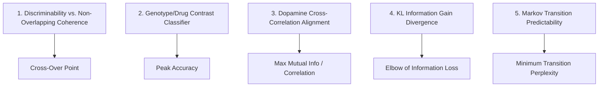

# Sliding Window Optimization Metrics & Parameters

This document details **5 optimization strategies** to determine the mathematically and biologically optimal sliding window configuration for behavioral strategy clustering, including their prerequisites and a **Gaussian Process (GP) Bayesian Optimization** framework.

---

## 1. Prerequisites for Each Metric

Before running an optimization sweep, it is critical to know what pipeline stages are required to compute each metric. Some can be calculated directly on raw syllable sequences, while others require the full feature extraction, UMAP, clustering, or neural photometry.

| Metric Idea | Stage 0: Raw Data As-Is | Stage 1: Embeddings Only | Stage 2: Full UMAP + Clustering | Stage 3: Aligned Photometry |
| :--- | :---: | :---: | :---: | :---: |
| **1. Discriminability vs. Coherence** | | | **Yes** (Needs strategy labels) | |
| **2. Genotype/Drug Decodability** | | | **Yes** (Needs strategy labels) | |
| **3. Dopamine Cross-Correlation** | | | **Yes** (Needs strategy labels) | **Yes** (Needs synchronized $DA(t)$) |
| **4. KL Information Gain** | **Yes** (Directly on syllable IDs) | | | |
| **5. Transition Predictability** | | | **Yes** (Needs strategy labels) | |

### Detailed Prerequisites Breakdown:
* **Idea 4 (KL Divergence)** is the only metric that requires **zero feature engineering, SVD, or clustering**. It can be evaluated instantly on raw RLE collapsed sequences, making it an excellent first-pass initialization check.
* **Ideas 1, 2, and 5** require running the full sliding window feature engineering pipeline (SVD + POS histograms + kinematics) followed by dimensionality reduction and clustering to obtain Strategy IDs ($S_t$) for each window.
* **Idea 3 (Dopamine Correlation)** requires strategy labels (Stage 2) plus the preprocessed and z-scored photometry signals (`signal_0_zscore_datta` or equivalent) synchronized to the frame indices.

---

## 2. Five Ideas for Window Optimization Metrics

### Idea 1: Twofold Crossing (Discriminability vs. Non-Overlapping Coherence)
* **Description**: Balance keeping window features distinct while keeping strategy labels temporally stable.
* **Formula**: Optimize the harmonic mean (F-score) of normalized discriminability $D(W)$ and chance-corrected coherence $C_{\text{corrected}}(W)$:
  $$f(W) = 2 \cdot \frac{D(W) \cdot C_{\text{corrected}}(W)}{D(W) + C_{\text{corrected}}(W)}$$
* **Prerequisites**: Stage 2 (UMAP + Clustering).

### Idea 2: Downstream Contrast Maximization (Genotype/Drug Decodability)
* **Description**: Select the window size that best exposes the behavioral signature differences between cohorts (WT vs. KI, or Saline vs. Amphetamine).
* **Formula**: Maximizes cross-validated prediction accuracy (or $F_1$ score) of a Random Forest or Logistic Regression classifier trained on session-wide strategy proportions.
* **Prerequisites**: Stage 2 (UMAP + Clustering + Genotype/Drug Metadata).

### Idea 3: Photometry Cross-Correlation Alignment (Neural Correlate)
* **Description**: Align strategy transitions with the underlying striatal Dopamine (dLight) signaling that modulates motivation and movement pacing.
* **Formula**: Maximize the cross-correlation coefficient or Mutual Information between strategy switch frames ($S_t \neq S_{t-1}$) and the photometry trace $DA(t)$.
* **Prerequisites**: Stage 3 (UMAP + Clustering + Synchronized Photometry).

### Idea 4: Syllable Syntactic Information Gain (KL Divergence)
* **Description**: Ensure that each window represents a specific, structured behavioral theme rather than a generic average of all behaviors.
* **Formula**: Compute the average KL divergence of the window's syllable probability distribution $P_{\text{window}}$ relative to the global baseline $P_{\text{global}}$:
  $$\text{KL}(W) = \frac{1}{M} \sum_{w=1}^{M} \sum_{i \in \text{vocab}} P_{\text{window}}(i) \log \left(\frac{P_{\text{window}}(i)}{P_{\text{global}}(i)}\right)$$
  Maximize the difference between structured information and sparse noise.
* **Prerequisites**: Stage 0 (Directly on collapsed syllable sequences).

### Idea 5: Strategy Markov Transition Predictability (State Perplexity)
* **Description**: Ensure strategy transitions follow a structured, predictable syntax (representing real behavioral planning) rather than a chaotic sequence.
* **Formula**: Minimize the perplexity of the strategy-to-strategy transition matrix $T$ (corrected for chance-level perplexity of shuffled sequences).
* **Prerequisites**: Stage 2 (UMAP + Clustering).

---

## 3. Bayesian Optimization via Gaussian Processes

Instead of running a slow grid search or brute-force sweep, we implement a **Gaussian Process Regressor (GPR)** to search the parameter space.

### The Parameter Search Space
We define a 2D parameter space to optimize jointly:
1. **Window Size ($W$)**: Continuous bounds between $2.0$ seconds and $60.0$ seconds (represented in log10 space to focus resolution on smaller window sizes).
2. **Number of POS Groups ($G$)**: Discrete integer bounds between $3$ and $10$.

$$\vec{\theta} = [\log_{10}(W), G]$$

### The Objective Function ($f(\vec{\theta})$)
We define our composite objective function (e.g., using Idea 1):
1. Receive parameter candidate $\vec{\theta}_k = [\log_{10}(W_k), G_k]$.
2. Compute sliding windows of size $W_k$.
3. Cluster syllable SVD embeddings into $G_k$ groups using K-Means to build the syntactic features.
4. Assemble hybrid vectors, project via UMAP, and cluster via GMM/HDBSCAN.
5. Compute the Normalized Discriminability $D(W_k)$ and Chance-Corrected Coherence $C_{\text{corrected}}(W_k)$ on disjoint windows.
6. Return the F-score:
   $$\text{Score}(\vec{\theta}_k) = 2 \cdot \frac{D(W_k) \cdot C_{\text{corrected}}(W_k)}{D(W_k) + C_{\text{corrected}}(W_k)}$$

### Bayesian Search Loop
1. **Initialization**: Sample 10–15 initial parameter points using Latin Hypercube Sampling (LHS) and evaluate the objective score.
2. **Gaussian Process Fitting**: Fit a Gaussian Process with a Matérn 2.5 kernel to model the landscape:
   $$y \sim \mathcal{GP}\left(m(\vec{\theta}), k(\vec{\theta}, \vec{\theta}')\right)$$
3. **Acquisition Function**: Use **Expected Improvement (EI)** or **Upper Confidence Bound (UCB)** to find the next point to query:
   $$\vec{\theta}_{\text{next}} = \arg\max_{\vec{\theta}} \text{EI}(\vec{\theta} \mid \mathcal{GP})$$
4. **Iterative Evaluation**: Run for $N=50$ iterations, updating the GP at each step, and log the optimization sweep progress directly to W&B.
5. **Output**: Select the $\vec{\theta}_{\text{opt}}$ that yields the peak score, and proceed to downstream clustering.

---

## 4. KL Divergence Optimization Sweep Results

We executed the Gaussian Process Bayesian Optimization sweeps ($N=500$ iterations) for both time-based and step-based sliding windows across the **IFDN** and **AMPH** datasets. The results are summarized below:

| Dataset & Window Type | Optimal Window Size ($W_{\text{opt}}$) | Optimal Step Ratio ($r_{\text{opt}}$) | Step Size ($S_{\text{opt}}$) | Max KL Score | W&B Run Link |
| :--- | :---: | :---: | :---: | :---: | :--- |
| **IFDN Step-Based** | 42.501 syllables | 0.3385 | ~14.4 syllables | 0.099171 | [kl-opt-ifdn-step](https://wandb.ai/sebeliassen/language_models_in_vivo/runs/mbn2oov5) |
| **IFDN Time-Based** | 60.000 seconds | 0.2407 | ~14.4 seconds | 0.226377 | [kl-opt-ifdn-time](https://wandb.ai/sebeliassen/language_models_in_vivo/runs/iify0dwu) |
| **AMPH Step-Based** | 70.304 syllables | 0.2961 | ~20.8 syllables | 0.102922 | [kl-opt-amph-step](https://wandb.ai/sebeliassen/language_models_in_vivo/runs/8ywj8pi1) |
| **AMPH Time-Based** | 60.000 seconds | 0.4066 | ~24.4 seconds | 0.193470 | [kl-opt-amph-time](https://wandb.ai/sebeliassen/language_models_in_vivo/runs/d3ct0aim) |

### Key Observations:
* **Time-Based Windows** systematically yield higher chance-corrected KL scores than step-based windows (~0.19–0.23 vs. ~0.10). This indicates that temporal alignment of behaviors captures more robust structure relative to shuffled controls compared to transition count alignment.
* **Window Size ($W_{\text{opt}}$)**:
  * For time-based sweeps, both IFDN and AMPH hit the upper bound of **60 seconds**, indicating that longer sequence motifs contain the most stable and descriptive syntactic features.
  * For step-based sweeps, the optimal window is **42.5 transitions** for IFDN and **70.3 transitions** for AMPH.
* **Step Size ($S_{\text{opt}}$)**:
  * The step sizes correspond to an overlap of ~60–75%, balancing high-resolution capture of strategy shifts with stable motif representations.

