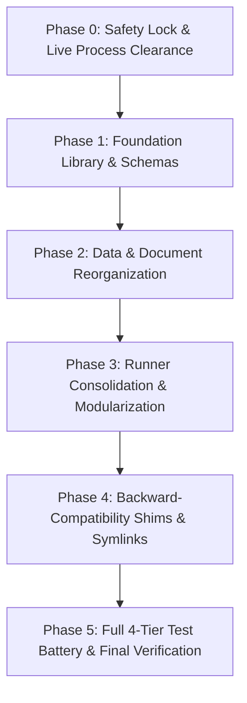

# Multiview Top-Bot Pipeline: SWE Refactoring & Architecture Plan

## Executive Summary
The `syllable_generation/multiview_top_bot_experiments` folder houses the foundational research and production codebase for the dual-camera (TopCam + BotCam) Keypoint-MoSeq (KPMS) pipeline across 118 sessions (18M frames). Over rapid iterations, it accumulated data sprawl, duplicated logic, and prototype debris. 

This document defines a software engineering (SWE) refactoring plan adhering to industry-standard engineering principles:
* **Separation of Concerns (SoC)**
* **Single Source of Truth (SSOT)**
* **Don't Repeat Yourself (DRY)**
* **Defensive Programming & Fail-Fast Validation**
* **Deterministic Verification & Regression Testing**

---

## 1. Current State Audit & Architectural Code Smells

### 1.1 Storage & Layout Clutter
| Category | File/Folder Count | Footprint | Primary Issue |
|---|---|---|---|
| **Large Pickle Caches** | 7 files | ~14 GB | Raw database dumps (`.pkl`) sitting in the root code directory. |
| **Fused Tracking Datasets** | 1 directory (118 `.h5` files) | 6.3 GB | Large binary tracking arrays mixed with source code. |
| **Historical Prototypes** | 9 directories | ~22 GB | Deprecated early experiments (`kpms_minimal_real_gpu`, `kpms_tandem_2session_test`, `multiview_kappa_search`) sitting beside active production. |
| **Root Python Scripts** | 35+ files | ~450 KB | Flat directory structure mixing fusion, training, evaluation, and plotting. |
| **Shell Scripts** | 6 `.sh` files | ~25 KB | Competing queue and launcher scripts with hardcoded paths. |
| **Output Figures & CSVs** | 6 files | ~400 KB | Evaluation CSVs and PNGs generated directly into source root. |

### 1.2 Code Duplication & DRY Violations
1. **Body Part Schemas & Mappings**:
   * `TOP_USE_BODYPARTS`, `BOT_USE_BODYPARTS`, `TANDEM_BODYPARTS`, and `BODYPART_REMAP` are identically hardcoded in at least 6 scripts:
     - `02_fuse_dorsal_ventral.py`
     - `fuse_multiview_cohort.py`
     - `fuse_all_tandem_cohort.py`
     - `run_tandem_production_50ar_200slds.py`
     - `run_tandem_cohort_production_50ar_200slds.py`
     - `run_cohort_2ar_2slds_test.py`
   * *Risk*: A bug fix or keypoint update in one file causes silent schema drift across the pipeline.
2. **Push Notification Boilerplate (`send_ntfy`)**:
   * Identical `urllib.request` dispatch functions copied across 8 different scripts.
3. **Pair Matching & Filename Parsing**:
   * Regex matching between dorsal top camera and ventral bottom camera files is duplicated between `audit_cohort_correlations.py`, `01_match_pairs.py`, and `enrich_video_refs_and_analyze_sequences.py`.
4. **Data Preprocessing & Resampling**:
   * Preprocessing loops (confidence masking, median filtering, precision conversion, coordinate recentering) are repeated across `run_tandem_production...` and `run_tandem_cohort_production...`.
5. **Ad-hoc Logging**:
   * Universal reliance on raw `print(..., flush=True)` with no log levels (`INFO`, `WARNING`, `ERROR`), timestamps, or unified formatters.

---

## 2. Target Directory Architecture

The restructured layout cleanly separates pipeline stages, source code, data caches, and historical archives:

```text
syllable_generation/multiview_top_bot_experiments/
│
├── 📁 core/                               # 📦 Shared Reusable Modules (DRY Engine)
│   ├── __init__.py
│   ├── schemas.py                         # SSOT for Keypoints, Body Parts & Configurations
│   ├── pair_matching.py                   # Dorsal-Ventral Pairing & Clock Synchronization
│   ├── fusion_engine.py                   # 2D->3D & Dorsal-Ventral Keypoint Fusion Routines
│   ├── io_utils.py                        # HDF5, Pickle, and Checkpoint Data Adapters
│   ├── logging_utils.py                   # Unified Structured Logging & ntfy Dispatcher
│   └── evaluation_metrics.py              # EML Calculation, Syllable Statistics & Downstream Tools
│
├── 📁 01_data_and_fusion/                 # 🔬 Data Ingestion & Preprocessing
│   ├── run_cohort_fusion.py               # Unified CLI for Fusing Top & Bot Tracking
│   ├── audit_alignment.py                 # Cross-Camera Correlation & Offset Audit
│   └── fused_h5_full_cohort -> ../data/fused_h5_full_cohort  [Symlink to Data Storage]
│
├── 📁 02_model_orchestration/             # 🚀 Model Fitting & Training Runners
│   ├── train_kpms_production.py           # Unified Configurable KPMS Runner (Replaces 4 scripts)
│   ├── launch_seed_queue.sh               # Robust Headless Launcher
│   └── configs/                           # Explicit YAML configs for AR / SLDS / Hyperparameters
│       ├── tandem_cohort_50ar_200slds.yml
│       └── smoke_test_2ar_2slds.yml
│
├── 📁 03_evaluation_and_eml/              # 📊 Model Comparison & Diagnostics
│   ├── compute_eml_rankings.py            # Automated Multi-Seed EML Evaluator
│   ├── export_production_results.py       # Package Final Syllable Sequences & HDF5 Summaries
│   └── compare_cohort_baselines.py        # K240K vs Tandem Benchmark
│
├── 📁 04_visualization_and_reports/       # 🎨 Figures, Plots & Reporting
│   ├── render_eml_figures.py              # Publication-Quality EML Comparison Visualizations
│   ├── render_trajectories.py             # Superimposed & Side-by-Side Syllable Trajectories
│   └── outputs/                           # Dedicated Directory for Output PNGs, PDFs, and CSVs
│
├── 📁 data/                               # 💾 Heavy Binary Data Storage
│   ├── fused_h5_full_cohort/              # 118 Dual-Camera Fused Tracking H5 Files
│   └── session_caches/                    # Unified Pickle Databases
│       ├── sessions_cohort_production.pkl # (Active 12.17 GB Cohort Pickle)
│       └── archive_prototypes/            # Deprecated Test Pickles
│
├── 📁 docs/                               # 📚 Methodology & Architectural Documentation
│   ├── DUAL_VIDEO_PIPELINE_ARCHITECTURE.md
│   ├── EXPERIMENT_PLAN.md
│   ├── FIBERPHOTOMETRY_REINTRODUCTION_GUIDE.md
│   ├── kpms_tandem_cohort_investigation.md
│   └── TANDEM_KPMS_MULTIVIEW_ALIGNMENT_AND_EMPIRICAL_BENCHMARK.md
│
├── 📁 archive_prototypes/                 # 🏛️ Quarantine for Historical Research (Read-Only)
│   ├── kpms_cpu_shape_test/
│   ├── kpms_minimal_real_gpu/
│   ├── kpms_tandem_2session_test/
│   ├── kpms_tandem_production/
│   ├── multiview_kappa_search/
│   └── legacy_scripts/
│
├── 🔒 kpms_tandem_cohort_production/      # 💎 Active Production Checkpoints & Models
│   ├── config.yml
│   ├── data/
│   ├── tandem_cohort_118sess_50ar_200slds/          (Seed 42)
│   ├── tandem_cohort_118sess_50ar_200slds_seed101/
│   ├── tandem_cohort_118sess_50ar_200slds_seed202/
│   ├── tandem_cohort_118sess_50ar_200slds_seed303/  (🏆 WINNING PRODUCTION MODEL)
│   └── tandem_cohort_118sess_50ar_200slds_seed404/
│
└── audit_cohort_correlations.py           # 🔗 Root Compatibility Shim (Zero Broken Imports)
```

---

## 3. Application of Software Engineering (SWE) Principles

### 3.1 Single Source of Truth (SSOT) via `core/schemas.py`
Instead of re-declaring body parts and hyperparameter dictionaries across every runner, define a canonical schema:
```python
from dataclasses import dataclass
from typing import List, Dict

TOP_USE_BODYPARTS: List[str] = [
    "nose", "left_ear_tip", "right_ear_tip", "neck", "mid_back",
    "mouse_center", "mid_backend", "mid_backend2", "mid_backend3",
    "tail_base", "left_shoulder", "left_midside", "left_hip",
    "right_shoulder", "right_midside", "right_hip", "head_midpoint"
]

BOT_USE_BODYPARTS: List[str] = [
    "nose_ventral", "snout_ventral", "left_ear_ventral", "right_ear_ventral",
    "chin_ventral", "chest_ventral", "forepaw_left", "forepaw_right",
    "belly_center", "hindpaw_left", "hindpaw_right", "tail_base_ventral"
]

BODYPART_REMAP: Dict[str, str] = {
    "snout": "nose_ventral",
    "left_ear": "left_ear_ventral",
    "right_ear": "right_ear_ventral",
    "tailbase": "tail_base_ventral",
}

@dataclass(frozen=True)
class PipelineHyperparameters:
    num_ar_iters: int = 50
    num_slds_iters: int = 200
    init_kappa: float = 7.5e13
    decrease_kappa_factor: float = 10.0
    target_fps: int = 60
    save_every_n_iters: int = 25
```

### 3.2 Don't Repeat Yourself (DRY) via Reusable Subsystems
* **Unified Notification & Monitoring (`core/logging_utils.py`)**:
  A single logging setup configuring standard formatters, timestamps, log rotation, and optional push notifications:
  ```python
  def notify_status(title: str, msg: str, priority: str = "default", tags: str = "robot"): ...
  def get_logger(name: str) -> logging.Logger: ...
  ```
* **Unified Pipeline Runner (`train_kpms_production.py`)**:
  Combines the separate `run_tandem_cohort_production_50ar_200slds.py`, `run_tandem_production_50ar_200slds.py`, and `run_cohort_2ar_2slds_test.py` into a single CLI tool parameterized by `--config`, `--seed`, and `--mode` (e.g. `production`, `test`).

### 3.3 Defensive Programming & Fail-Fast Invariants
* **Pre-Flight Sanity Checks**: Validate dataset existence, GPU VRAM availability, and checkpoint directory write permissions before executing JAX allocations.
* **Bit-Exact Parity Check on Save**: Every checkpoint save operation integrates the 7-pillar compaction validation to ensure no corrupted files are ever written to disk.
* **Deterministic Random Seed Handling**: Seeds explicitly set across `jax.random.PRNGKey`, `numpy.random.seed`, and `random.seed`.

---

## 4. Functionality Verification & Guardrail Battery

Refactoring must never alter mathematical outputs or break existing dependencies. We enforce a **4-Tier Verification Suite**:

### Tier 1: Backward-Compatibility & Import Verification
* **Goal**: Guarantee that external scripts in the repo (such as `VALIDATION_REPORT.md`, `KPMS_MONKEYPATCHING_AND_MEMORY_SCALING_GUIDE.md`, and test runners) continue to execute without `ModuleNotFoundError` or broken relative paths.
* **Test**:
  ```python
  def test_root_shims_and_imports():
      from syllable_generation.multiview_top_bot_experiments.audit_cohort_correlations import find_matched_pairs
      assert callable(find_matched_pairs)
  ```
* **Implementation**: We leave thin wrapper shims in the root (e.g. `audit_cohort_correlations.py` containing `from core.pair_matching import find_matched_pairs`) and symlinks for data paths.

### Tier 2: Mathematical Parity ("North Star" Verification)
* **Goal**: Ensure refactored data fusion and EML code produce identical numbers down to machine precision ($10^{-12}$).
* **Checks**:
  1. **EML Parity**: Run refactored `compute_eml_rankings.py` on the 5 cohort seeds and assert output matches `tandem_cohort_eml_model_rankings.csv` exactly:
     * Seed 303: `270,795,506.86 ± 172,654.84`
     * Seed 101: `270,787,545.97 ± 172,674.22`
  2. **Fused Coordinate Parity**: Run refactored `fusion_engine.py` on a sample session and verify `np.testing.assert_array_equal` against `fused_h5_full_cohort/<session>.h5`.

### Tier 3: End-to-End Pipeline Smoke Test
* **Goal**: Validate that the refactored CLI runners can execute the full lifecycle (data ingestion -> JAX PCA -> Gibbs sampling -> checkpoint writing -> results extraction) without raising exceptions.
* **Test Protocol**:
  * Execute `train_kpms_production.py` using `--config configs/smoke_test_2ar_2slds.yml` (2 AR + 2 SLDS iterations on a 2-session fixture).
  * Assert checkpoint is written, packed, and verified.

### Tier 4: Dry-Run CLI & Script Matrix
* **Goal**: Confirm all shell scripts (`launch_*.sh`) and Python CLI entrypoints accept valid arguments and parse `--help` and `--dry-run` successfully.

---

## 5. Phased Execution Roadmap



1. **Phase 0 (Safety Check)**: Confirm background compaction process (PID `245472`) is finished or clear of `multiview_top_bot_experiments/`. *(Status: Stage 2 complete, cleared!)*
2. **Phase 1 (Core Module Build)**: Create `core/schemas.py`, `core/logging_utils.py`, `core/pair_matching.py`, `core/fusion_engine.py`, and `core/io_utils.py`.
3. **Phase 2 (File Relocation)**: Move documentation to `docs/`, legacy test directories to `archive_prototypes/`, and large pickle files into `data/session_caches/`.
4. **Phase 3 (Runner Unification)**: Create `02_model_orchestration/train_kpms_production.py` to replace redundant runners.
5. **Phase 4 (Compatibility Shims)**: Establish root-level import shims and data symlinks.
6. **Phase 5 (Verification Run)**: Execute the automated test battery; produce a verification certification report.
